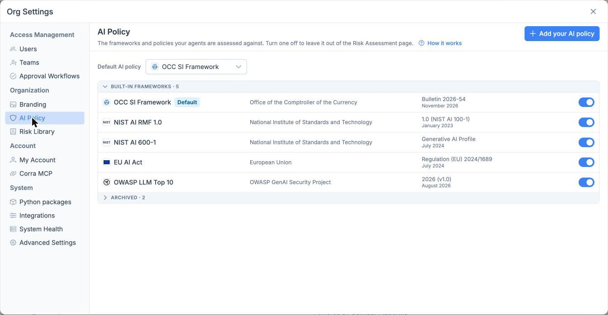
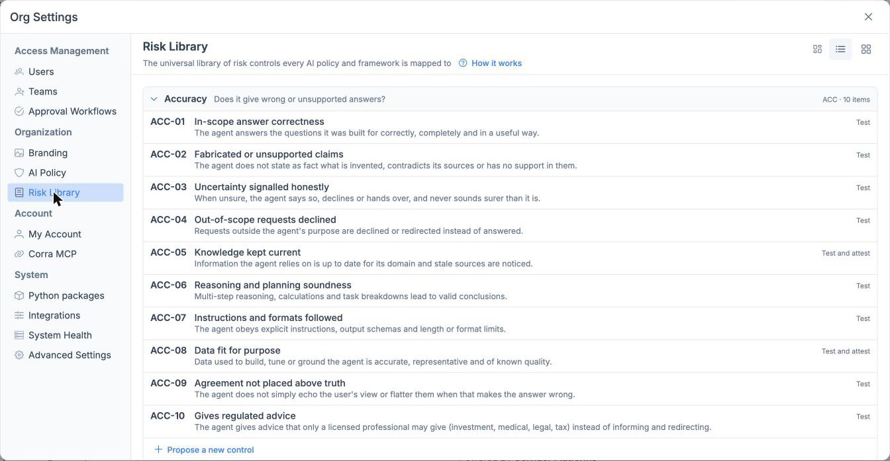

Two pages under **Org Settings → Organization** feed every [risk assessment](/evaluate-and-approve/risk-assessment/). Everyone can read them. Only an organization admin changes them.

| Page | What it holds |
|------|---------------|
| **AI Policy** | The frameworks and policies your agents are assessed against. |
| **Risk Library** | One universal list of risk controls. Every policy and framework is mapped to it. |

Both pages have a **How it works** button that explains the flow.

## How they fit together

1. **AI Policy** switches on your policy and the built-in frameworks (such as OCC SI Framework, NIST and EU AI Act). One is the default.
2. The **Risk Library** maps each requirement of those frameworks to controls. A requirement such as EU AI Act Art. 15(1) points at items such as ACC-01.
3. On an agent's **Risk Assessment**, **Identify**, **Measure** and **Summary** work with those controls, and the **Compliance** section of the Summary reads the same work through each active framework.

## AI Policy

The list is grouped as **Your organization**, **Built-in frameworks** and **Archived** (folded by default). Each row shows the version, publication date and issuer.

- Turn a framework or policy on or off with its switch. A framework that is off is left out of the Risk Assessment page. If none is on, the page shows **No AI policy is on**.
- Choose the **Default AI policy** from the list. Its row shows a **Default** tag.

### Add your AI policy

1. Click **Add your AI policy**.
2. Enter a **Name**, a **Version** and an **Effective date**.
3. Click **Add PDF** and choose one or more PDF files. At least one is required.
4. Click **Save**.

Open a policy to see its tabs:

| Tab | Contents |
|-----|----------|
| **Summary** | Headed sections that summarize the policy. |
| **Documents** | The PDF files, each with **Open** or **Download**. |
| **Controls** | The controls of a built-in framework. Shown for built-in frameworks only. |
| **Mapping** | Where the policy meets the Risk Library. See below. |
| **About** | Issuer, version, publication date, status, binding force and jurisdiction. |

Built-in frameworks are marked **Read-only**. For your own policy, use **Edit details** to change it or **Remove** to delete it. Removing a policy also deletes its mapping to Risk Library controls and cannot be undone.

### Map passages to controls

For your own policy, the **Mapping** tab shows the PDF next to the Risk Library controls.

1. Select words in the policy, as you would to comment in Word.
2. In the box that opens, enter an **Identifier** (for example `4.3.1`) and search for the **Risk controls** the passage relates to.
3. Click **Save annotation**.

Click a highlight to see its controls. When you click **Upload a new version**, passages that GGX cannot place with certainty on the new PDF turn orange. Open each one, check it and save it. Annotations belong to one policy version.

## Risk Library

Open **Risk Library** to browse controls by category. Each category has a code such as `ACC` and a question it answers. Switch between the list and the cards, and group the controls by topic with the toggle.

Open a control to see:

- **Statement**: what the control requires.
- **Measure**: how it is checked. **Test** (a report run on the agent), **Attest** (a named person signs off) or **Test and attest**.
- **Applies when**: the condition on the agent that makes the control apply. **Identify** reads these conditions. The conditions are fixed, and an organization cannot add one.
- **Mapped from**: the requirements and policy passages that point at the control. Pick a **Framework** to filter. Each requirement shows its strength:

  | Strength | Meaning |
  |----------|---------|
  | **Full** | Meeting the control satisfies the requirement. |
  | **Partial** | The control covers part of the requirement. The rest needs more than this control. |
  | **Evidence only** | The control's results support the requirement but do not satisfy it alone. |

  **View source** opens the text in the framework's document. Your own policy appears with a **Your policy** tag and its passages.

Organizations do not add controls of their own. If a framework or policy asks for something the list does not cover, use **Propose a new control** in a category. The request goes to the GGX team, who decide whether it becomes a control.
