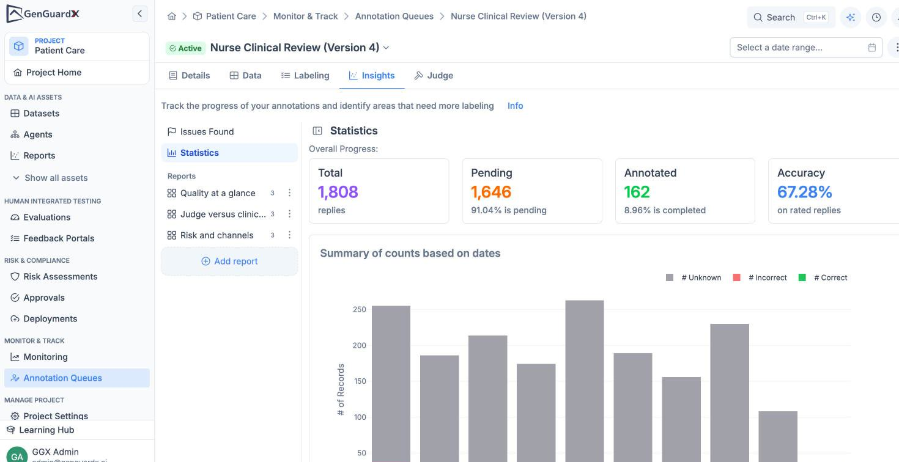

It is important to add a Human element when monitoring activity in Production as not all trends can be caught in an automated way. New trends are not always caught using programmatic approaches, but programmatic approaches are useful for repetitive tasks. Bringing a balance of both evaluation methods is key to maintaining a good healthy production system.

The Annotation Queue capability is designed to bring in the human evaluation and labelling of production data - but also do it in an efficient way to reduce human error. This capability allows the validation of model outputs in real time by having annotators assess and label the production outcome. The capability can help track a variety of metrics, both standard and custom, on raw and annotated production data, organized digitally for the stakeholders.

The capability significantly improves the usual approach to annotating production data using Excel and Google Sheets, creating a more transparent and auditable system to monitor live performance.

## Where annotation queues live

Annotation queues are listed under **Monitor & Track → Annotation Queues**, grouped by folder (for example production and staging traffic), with their status. Filter them by **Annotation Objective** or status, and click **Create** to add one.

## Setting up a queue

A queue's **Details** tab configures what annotators see and record. Click **Edit** to change it.

- **Name** and **Description**: what the queue reviews and who reviews it.
- **Annotation objective**: what one annotation covers.
    - **Entire Chat**: one rating for the whole conversation.
    - **Every Turn**: each response of the agent is annotated separately.
    - **Every Record**: each row of the data is its own annotation.
- **Feedback columns**: the fields annotators fill, such as the built-in **Is Accurate** like/dislike, a **Judge Verdict**, or a free-text comment.
- **Map columns**: the **ID Column**, the **Date Column** and the **Labeling Columns** shown to annotators.
- **Chat transcript**: the column holding the conversation, and optionally the persona name and description, so chats are displayed as transcripts.
- **Chat configuration**: closing questions asked when an annotator finishes reviewing a chat.
- **Assignees**: optionally assign records to specific annotators.

## Working in a queue

A queue has these tabs:

- **Data**: view or export the raw data.
- **Labeling**: the records to annotate, with their labeling columns, a **View Transcript** button for chats, the feedback summary, review status and judge verdict. Use the date range at the top to focus on a period, and **Create test dataset** to turn reviewed records into a dataset for evaluations.
- **Insights**: progress (total, pending, annotated and accuracy on rated records), counts over time, **Issues Found**, and reports. Click **Add report** to add your own.
- **Judge**: an LLM judge that pre-labels records so annotators can focus where it matters.

### Automated judging

On the **Judge** tab, turn on **Enable Automated Judging** and write the **Instructions for the Judge**. The instructions can reference columns of the data, such as `{Topic}` or `{messages}`, and define the verdicts the judge returns. Click **Rerun Judge** to judge the records again after changing the instructions. Judge verdicts appear in the Labeling tab next to the human review, so you can see where the judge and the reviewers disagree.

## Inviting annotators

All users with access to the project's annotation queues can collaborate on labeling. The platform records every label change and lets annotators leave notes.

## Benefits of Annotation Queues:

- **Easy onboarding** of data annotated in an external environment.
- Easy to follow and **intuitive user-interface** to annotate data.
- **Auditable annotations**, platform records all modifications to the data and labels.
- **Automatic ingestion** of production data.
- **Enhanced Collaboration** with other reviewers.
- **Automated Performance and Progress** tracking.
- Smart algorithms to **expedite the labeling process**.

:::note[From labels to better evaluation]
Labelled and ground-truth data is the raw material for continuous improvement. Recurring failure categories surfaced during annotation can be codified into new judges and [reports](../../evaluate-and-approve/reporting/), which then run across all agents — turning human insight into automated checks over time. The same labelled data also serves as the ground truth for [validating those evaluators](../../evaluate-and-approve/simulation/#validating-an-evaluator).
:::
