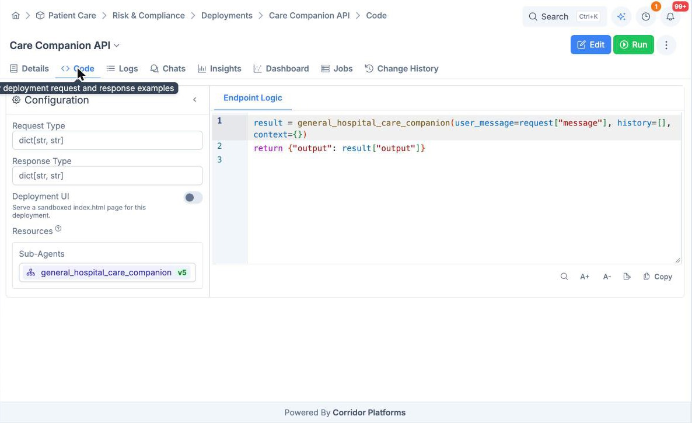

The **Code** tab of a deployment holds everything that defines how it behaves. The left **Configuration** panel (collapse it with **Hide Configuration**) has the settings; the right side has the code.

The example here is a deployment that takes a customer question and returns an answer from a support agent.

## Request and response types

- **Request Type**: the data type of what callers send. GGX casts the incoming request to this type before your code runs.
- **Response Type**: the data type of what your code returns. GGX casts the response to this type before sending it back.

Leave a type empty to skip the cast. With no **Response Type**, the response must be JSON-compatible; otherwise the call fails with a "not JSON compliant" error. The types also appear in the list of deployments.

## Resources

Click **Add Resources** to pick the registered LLMs, prompts, RAGs, sub-agents and global functions your code uses, so your code can use them. Use **Create New** to make an LLM, prompt or RAG without leaving the page.

## Endpoint logic

The **Endpoint Logic** tab is the Python code that handles a request. It receives the `request` and returns the response. The resources you added are available in the code.

## Custom interface

Turn on **Deployment UI** to serve a sandboxed `index.html` page for the deployment. A **UI Logic** tab appears next to **Endpoint Logic**. Write the complete `index.html` document there. When you turn the toggle on with an empty page, GGX fills in a starter page.

Once saved, the **Details** tab shows an **Open UI** button that opens the page in a new tab. The page runs inside a sandbox and calls the deployment as the person who opened it, so it needs no key of its own. It can load scripts and styles from CDNs.

Use it for a small front end on top of the agent, such as a chat box for testers, without hosting a separate web app.
