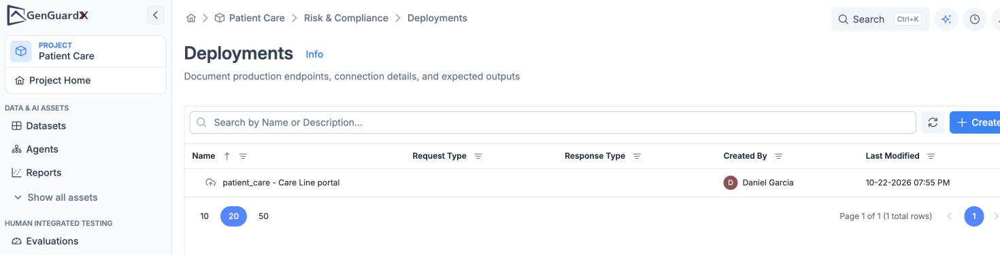
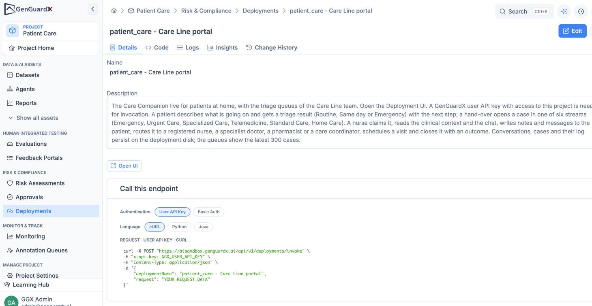

## Deployments in GGX

Every production deployment of a project is recorded under **Risk & Compliance → Deployments**, so reviewers can see where each approved agent runs and how it is called. Click **Create** to document a new one.



A deployment has these tabs:

- **Details**: the name and description, an **Open UI** button when the deployment has its own interface, and **Call this endpoint**, with ready-to-copy requests in cURL, Python or Java, authenticated with a GGX **User API Key** or **Basic Auth**.
- **Code**: the request and response types, the resources it uses, the endpoint logic and an optional custom interface. See [Request and Response Types and Custom Interfaces](../deployment-request-types/).
- **Logs**: the request logs of the deployment.
- **Chats**: collect and review conversations with the deployment. See [Deployment Jobs, Chats and Insights](../deployment-jobs/#chats).
- **Insights**: custom figures drawn from the deployment's invocations. See [Deployment Jobs, Chats and Insights](../deployment-jobs/#insights).
- **Dashboard** and **Jobs**: run the deployment over a table of requests, on demand or on a schedule, with alerts. See [Deployment Jobs, Chats and Insights](../deployment-jobs/#run-a-job-on-a-deployment).
- **Change History**: every change to the deployment.



The targets an agent can be deployed to are listed under **Deployment Platforms** in [Org Settings → Integrations](../../integrations/). They include Docker, Kubernetes, AWS Lambda, Amazon ECS (Fargate), Amazon Bedrock AgentCore Runtime, Google Cloud Run, Databricks Model Serving, Databricks Agent Runtime and Hugging Face Spaces.

### Size limit for responses

A deployment's response is read back from the Python kernel that runs it, and a response larger than the limit is refused. The limit is `KERNEL_MAX_RESULT_BYTES`, 6 MB by default, and the same setting limits the result of a chat turn. Self-hosted installs can raise it in their settings file. An install that set `CHAT_MAX_RESULT_BYTES` before must now set `KERNEL_MAX_RESULT_BYTES` instead.

## Exporting the production artifact

To deploy an approved agent, open it and use the **⋮** menu: **Deploy** records a new deployment, and **Export As Python Code** downloads the locked artifact for your own pipeline.

### Deploy bundle for a platform

**Deploy** opens the **Deploy agent** dialog, where you choose a platform. GGX builds a bundle for that platform. [Deployment platforms](../deploy-platforms/) lists the platforms and how administrators turn them on or off. Platforms disabled for your organization or project appear under **Disabled** with the reason, and cannot be chosen.

After you choose a platform the dialog shows:

- **What you need**: the prerequisites for the platform.
- **Keys this agent needs**: the environment variables the agent reads, such as provider keys. Have them ready. GGX never puts your keys in the bundle. The steps show where to paste each one.
- **Download the bundle**: a zip with the agent's code, the files the platform needs and a README with the steps. **Download** saves it.
- **View**: opens the zip in a preview dialog so you can read every file before you download. For **Databricks Agent Runtime**, **View** opens **Files of the app** instead.
- The steps, with the most direct way first (**Most direct**) and fallbacks below it (**If that does not work**). Commands are ready to copy.

Some steps contain values only you know, such as a region or an account ID. They are highlighted. Select one, type the value and choose **Use this value**: it is filled into the steps and into the files of the next download or preview. If you fill in values after downloading, the dialog tells you to download again so the files have them too.

Record the deployment afterwards under **Risk & Compliance → Deployments** so reviewers can see where the agent runs.

### Export as Python code

**Export As Python Code** opens a dialog with a short code sample that calls the agent, and the exported code of the agent. Tick **Hide Decorators** to comment out the GGX decorators in the code, and choose **Download ZIP** to save the files. Use this for a pipeline of your own, when none of the platforms fits.

Typically, production execution environments are kept separate and managed to ensure 100% uptime as these are mission-critical systems for organizations.

To tackle the air gap that these systems require - all analytics registered on the platform can be exported out from the system to be put into a Production Execution Environment. These production artifacts are locked to ensure they are not tampered with when they are promoted to production. And there is **NO extra dependency** required on the production side from GGX - i.e. there is no requirement for a license key or a GGX installation in production!

The production artifact aims to:

- Extract the logic/items registered in GGX - to then use it outside GGX
- Self-sufficient with all information encapsulated in the artifact
- Have minimal dependencies on the runtime-environment where the artifact is run later

Typically a robust Continuous Deployment system is recommended to ensure that Governance is maintained while the production-artifacts are promoted. For example, you can use:

- Jenkins
- GitHub Actions
- AWS Code Agents
- Azure DevOps Agents
- Gitlab CICD
- CircleCI

And many others.

## Deploying as APIs

If the production system supports calling APIs - the production-artifact can also be wrapped using an API layer and exposed as a REST or SOAP API which can be called by the production system.

Typically the APIs should be considered state-less and any extra state management should be handled outside the API, but can be provided in the request payload of the API.

Production Artifacts can be deployed as APIs using containerized solutions like:

- Docker Compose
- Kubernetes
- AWS Elastic Container Service (ECS)
- AWS Elastic Kubernetes Service (EKS)
- AWS Fargate
- Pivotal Cloud Foundry
- Azure Container Instances
- Google Cloud Run
- Google Kubernetes Engine (GKE)
- VMWare TKGI

The API can also be deployed using application management solutions (server-based or serverless) like:

- AWS Beanstalk
- AWS Lambda
- Google App Engine (GAE)
- Google Functions
- Azure App Service
- Azure Functions

## Custom Production Setup

Not all production systems support running direct Python scripts or calling APIs - and some require providing specific GenAI components in a custom interface. To handle cases like this, while Robotic Process Automation (RPA) could be used - many times it is not worth the trouble that RPA brings with it.

Because of the transparency that GGX's Inventory management provides, each part of the agent can be deployed independently.
For example:

- All the LLM configurations like `seed`, `temperature`, `top_k`, etc. can be extracted from the agent
- The prompt templates can be extracted and provided to the production system directly
- Knowledge files from RAGs can be locked and sent to production

## Internals of the Production Artifact

The artifact generated from the platform is independent of the platform and can run in an isolated runtime environment
or production environment. The information stored in the artifact is useful in many cases, where we might want to:

- check the metadata for the objects
- check the input tables and columns used
- see the lineage and relationship between the objects
- run the entire artifact or some components of the artifact to get complete or intermediate results

The artifact consists of the following files:

```none
model_a.b.c
├── metadata.json
├── input_info.json
├── ... (additional information about features etc. used)
└── python_dict
    ├── __init__.py
    ├── versions.json
    └── Additional information
```

The **metadata.json** contains metadata information about the folder it is in. It will have
information about the model, its inputs, its dependent variable, etc. It also has any other
metadata information registered in the platform like Groups, Permissible Purpose, etc.

The **versions.json** contains the versions of libraries that were used during the artifact
creation - python version, any ML libraries, etc.

The **input_info.json** contains the input data tables needed to be sent to the artifact's main() function.

The `__init__.py` file inside the **python_dict** folder contains the end-to-end Python function
which can be used to run the entire artifact. It supports API execution in a Python environment.

To run the artifact, simply call the `main()` function in the artifact with the needed data.  
The `python_dict/__init__.py` contains a `main()` function into which data can be sent - in the form of a  
python-dict for low-latency execution. A dataset in the dictionary format is described as a dict  
with type/values
