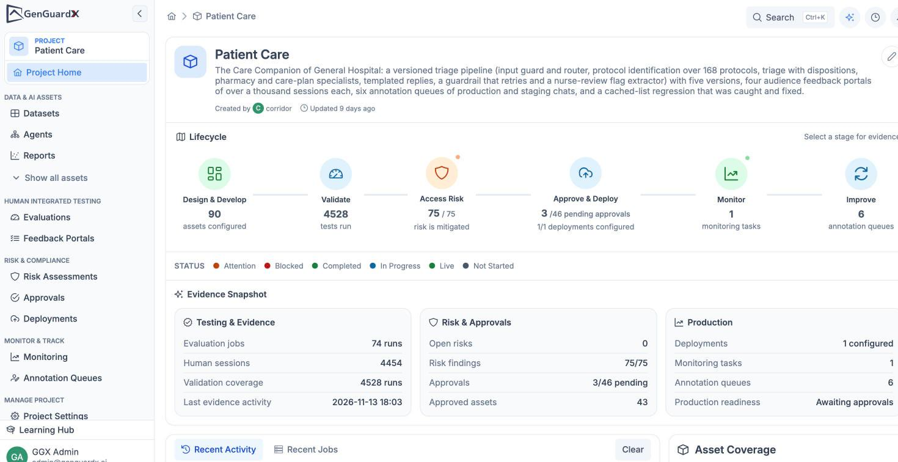
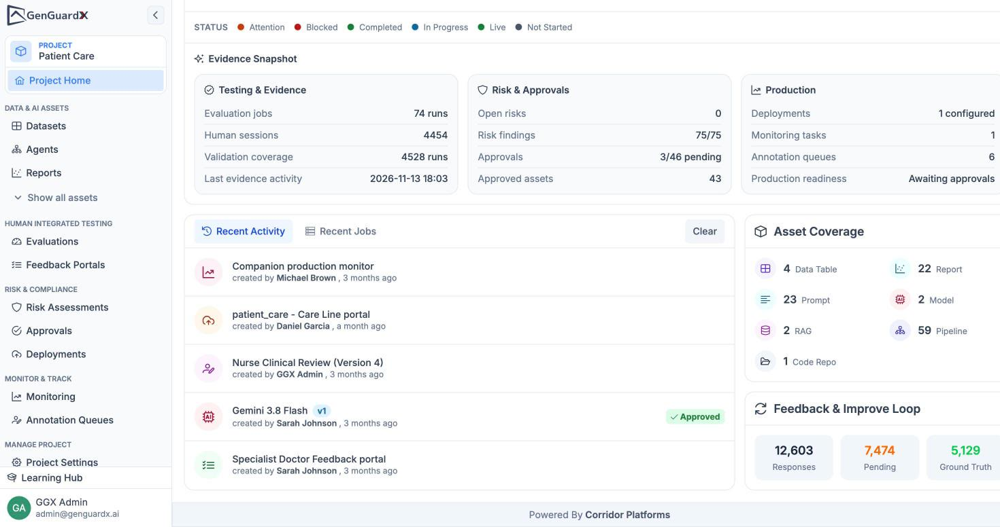

Review committees and project managers need one place that shows where every GenAI use case stands: what has been built, how far it has been tested, which risks are mitigated, what is waiting for approval, and what runs in production. In GGX, that place is **Project Home**, the first page of every project.

## Lifecycle

The **Lifecycle** band follows the use case through its six stages, each with its headline number:

| Stage | What it counts |
| --- | --- |
| **Design & Develop** | Assets configured in the project. |
| **Validate** | Tests run, across evaluation jobs and human sessions. |
| **Access Risk** | Risks mitigated out of all risks in the project's risk assessments. |
| **Approve & Deploy** | Pending approvals, and deployments configured. |
| **Monitor** | Monitoring tasks. |
| **Improve** | Annotation queues that feed findings back into development. |

A coloured dot marks each stage's status: **Attention**, **Blocked**, **Completed**, **In Progress**, **Live** or **Not Started**. Select a stage to see the evidence behind it.

## Evidence snapshot

Below the lifecycle, the **Evidence Snapshot** summarises the evidence a reviewer asks for:

- **Testing & Evidence**: evaluation jobs, human sessions, validation coverage and the last evidence activity.
- **Risk & Approvals**: open risks, risk findings, pending approvals and approved assets.
- **Production**: deployments, monitoring tasks, annotation queues and production readiness (for example *Awaiting approvals*).

## Activity and coverage

- **Recent Activity** and **Recent Jobs** list what changed in the project and which jobs ran, with links to each object.
- **Asset Coverage** counts the project's assets by type: data tables, prompts, models, RAGs, agents (pipelines), reports and code repositories.
- **Feedback & Improve Loop** counts the responses collected from feedback portals and annotation queues, how many are pending review, and how many became ground truth.

## Drilling down

Each part of Project Home links to the page that holds the detail:

- Evaluations and human sessions: [Human Integrated Testing → Evaluations](../../evaluate-and-approve/).
- Risks: [Risk & Compliance → Risk Assessments](../../evaluate-and-approve/risk-assessment/).
- Approvals: [Risk & Compliance → Approvals](../../evaluate-and-approve/approval-workflows/#following-an-approval).
- Deployments: [Risk & Compliance → Deployments](../direct-to-production/#deployments-in-ggx).
- Monitoring: [Monitor & Track → Monitoring](../performance/) and [Annotation Queues](../annotation-queues/).

What each person can see and do in a project is governed by their [role](../../register-and-refine/collaboration/#access-management).
