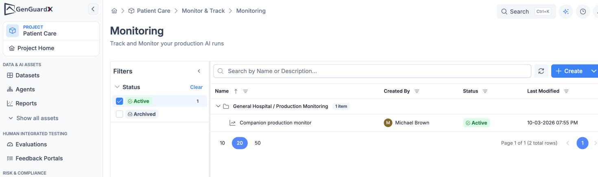
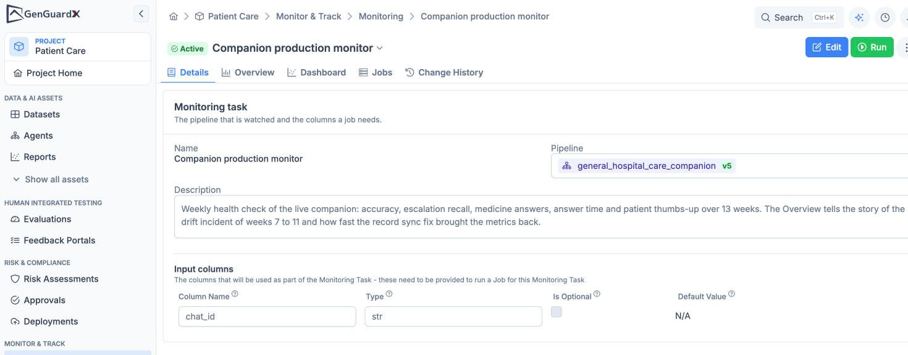
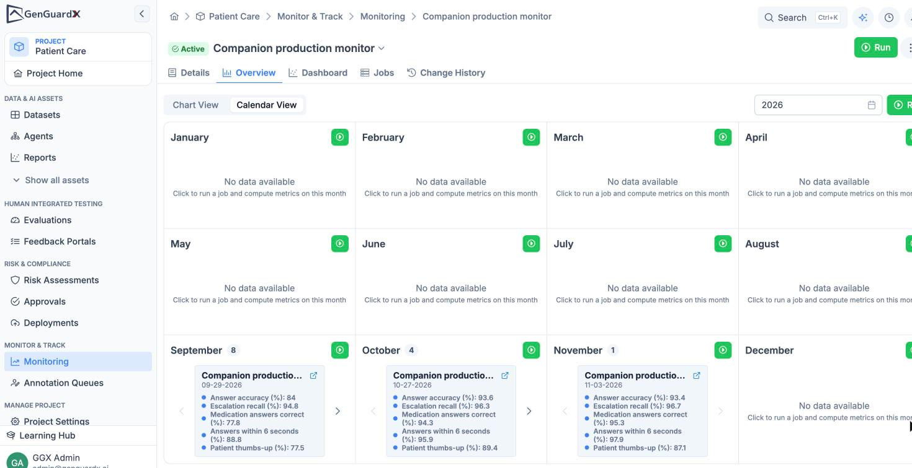

A **monitoring task** watches an agent in production. Each time it runs, it computes its reports on a sample of production data, and GGX charts the metrics of every run over time, so drift and regressions show up as soon as they happen.

## Where monitoring lives

Monitoring tasks are listed under **Monitor & Track → Monitoring**, grouped by folder, with their creator, status (**Active** or **Archived**) and last change. Click **Create** to add one.

## Setting up a monitoring task

The **Details** tab of a monitoring task holds:

- **Pipeline**: the agent, at a specific version, that the task watches.
- **Description**: what the task checks and why.
- **Input columns**: the columns a job needs, with their type, whether they are optional and their default value, for example a `chat_id` to identify each production chat.

Click **Edit** to change the task, and **Run** to run a job now.

## Tracking metrics over time

The **Overview** tab shows how each metric moved across runs.

- **Chart View** plots every metric over time, with a dotted line for its threshold, so you can see when a metric crossed its target and when it came back. Use **Filter by date range** to zoom in, and **Add Custom Figure** for your own chart.
- **Calendar View** shows the runs of each month with their metric values. Click the run button of a month to run a job and compute its metrics.

## Looking at a single run

The **Dashboard** tab shows the reports of one monitoring job, by default the latest one. It has the same **Job Details** and **Job Results** tabs as an evaluation job, plus one tab per report. Click **Change** to look at another run, or **Rerun** to run it again.

The **Jobs** tab lists every run with its submission date, number of records and status, and **Change History** records every change to the task.

## More actions

The **⋮** menu of a monitoring task offers:

- **Use with SDK**: shows how to work with the task from the GGX SDK, for example to run its jobs from your own scheduler.
- **Move to Another Project**.
- **Archive**: keep the task and its history, but stop treating it as active.
- **Delete Monitoring**.

## Alerting on production behaviour

For human review of production data, route records to [Annotation Queues](../annotation-queues/).
