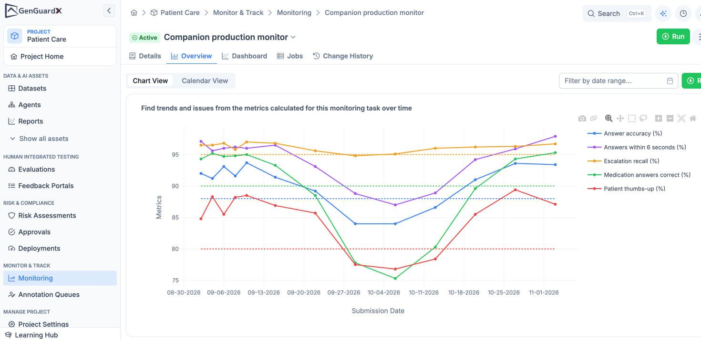
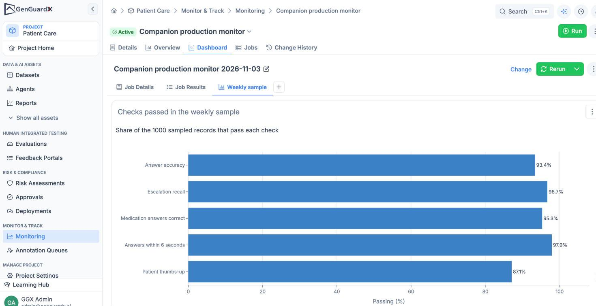

A **monitoring task** watches an agent in production. Each time it runs, it computes its reports on a sample of production data, and GGX charts the metrics of every run over time, so drift and regressions show up as soon as they happen.

## Where monitoring lives

Monitoring tasks are listed under **Monitor & Track → Monitoring**, grouped by folder, with their creator, status (**Active** or **Archived**) and last change. Click **Create** to add one.

## Setting up a monitoring task

The **Details** tab of a monitoring task holds:

- **Pipeline**: the agent, at a specific version, that the task watches.
- **Description**: what the task checks and why.
- **Input columns**: the columns a job needs, with their type, whether they are optional and their default value, for example a `chat_id` to identify each production chat.

Click **Edit** to change the task, and **Run** to open the job form and run a job.

## Running a task on a schedule

A monitoring task is only useful if it runs without someone remembering to click. In the job form, open the **Scheduling** panel:

- **Start Date** and **Time**: when the first run starts. Leave them empty to run immediately (**Today** and **Run Immediately** are the placeholders).
- **Recurrence**: how often the run repeats after the first one.

The **Recurrence** list is built from the start date, so it offers the day that date falls on. The options are **Does not repeat**, **Hourly**, **Daily**, **Weekly on** that weekday, **Monthly** (on the Nth weekday, on the last weekday, or on that date of the month), **Quarterly** on the Nth or last weekday, and **Annually** on that date. The form lists the first iterations so you can check the dates before you run.

When a run ends, GGX schedules the next one. If the job filters its data by a date range, the range moves forward by the same interval, so each run looks at the new period. Every run is named after the job with an **Iteration** number, and appears in **Calendar View** and in the **Jobs** tab.

For a weekly check of last week's chats, set the start date to a Monday, the time to early morning and **Recurrence** to **Weekly on Monday**.

## Alerts when a metric crosses its threshold

Thresholds show on the chart as dotted lines. To be told when a run crosses them:

1. In the job form, set **Metric Thresholds** for each metric: a lower and an upper threshold. A metric inside both is fine.
2. Open the **Alerts** panel and choose people in **Notify**.

When a run completes and any metric is below its lower threshold or above its upper threshold, each person gets one notification in GGX that lists every metric that breached. If your administrator has configured an email provider, they also get an email. Only active users who can read the monitoring task are notified.

Recurring runs keep the same people, so you set this once. The alert uses the metric's own thresholds, so the chart and the alerts always agree.

## Tracking metrics over time

The **Overview** tab shows how each metric moved across runs.

- **Chart View** plots every metric over time, with a dotted line for its threshold, so you can see when a metric crossed its target and when it came back. Use **Filter by date range** to zoom in, and **Add Custom Figure** for your own chart.
- **Calendar View** shows the runs of each month with their metric values. Click the run button of a month to run a job and compute its metrics.

### Custom figures

Click **Add Custom Figure** on the **Overview** tab to add a chart, table or summary of your own, for example the share of runs that failed a check. Fill in:

- **Name**.
- **Width**: **50%** or **100%** (100% is the default).
- **Figure Logic**: Python code that returns a Plotly figure, a Markdown string or a pandas DataFrame, which is shown as a table. The metric data of the task is in the variable `data`, a DuckDB relation. Use `data.df()` for a pandas DataFrame. **View Examples** shows a Plotly, a Markdown and a Table example.

Click **Save**. **Edit** and **Delete** are on each figure.

## Looking at a single run

The **Dashboard** tab shows the reports of one monitoring job, by default the latest one. It has the same **Job Details** and **Job Results** tabs as an evaluation job, plus one tab per report. Click **Change** to look at another run, or **Rerun** to run it again.

The **Jobs** tab lists every run with its submission date, number of records and status, and **Change History** records every change to the task.

## More actions

The **⋮** menu of a monitoring task offers:

- **Use with SDK**: shows how to work with the task from the GGX SDK, for example to run its jobs from your own scheduler.
- **Move to Another Project**.
- **Archive**: keep the task and its history, but stop treating it as active.
- **Delete Monitoring**.

## Human review of production data

Metrics catch what you can measure. For records that need human judgement, route them to [Annotation Queues](../annotation-queues/).
