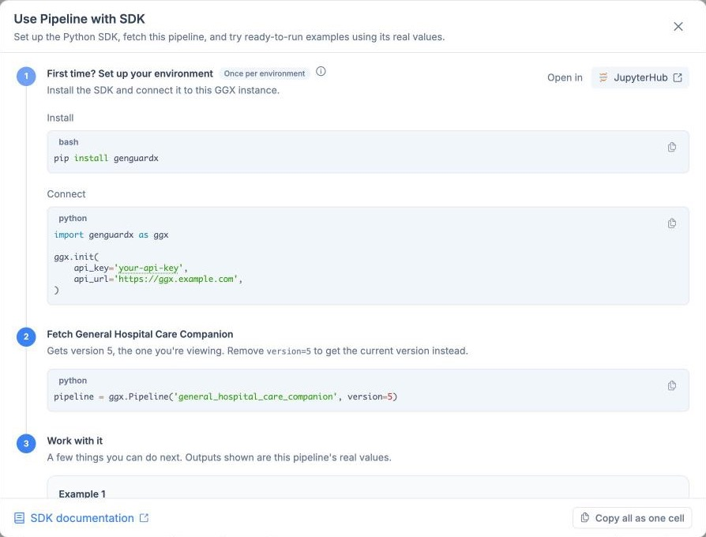

The `genguardx` package is the Python client for GGX. Use it from a notebook or a script to look up registered objects, load datasets, read the results of simulations, and read the conversations and logs that GGX collects.

To create or update objects from code, use GGX Sync instead. See [GGX Sync](../../register-and-refine/sync/). It covers the declare decorators, `ggx.sync` and the `ggx sync` command, so this page does not repeat them.

## Install and sign in

```bash
pip install genguardx
```

Copy your API key from **My Account** in GGX, then initialize the session.

```python
import genguardx as ggx

ggx.init(api_key="your-api-key", api_url="https://your-ggx-instance.example.com")
```

`init` prints the user you are signed in as. Pass `silent=True` to skip that. `ggx.whoami()` prints it again, and tells you what to fix if the key is not accepted. Everything you do in the session is recorded under that user, with that user's permissions.

The package also installs the `ggx` command, which reads `GGX_API_KEY` and `GGX_URL` from the environment. Its commands are `ggx whoami` and `ggx sync FILE`.

On an agent, choose **⋮ → Use with SDK** to see these steps with the agent's own values: install, connect, fetch the agent and try examples. **Copy all as one cell** copies everything, and **Open in JupyterHub** opens a notebook. The connect step contains an API key, so treat what you copy as a secret.



## How objects work

Every class below loads an object from GGX when you create it, and exposes what it found as read-only properties.

- Look an object up by `name` (and `alias` where the class has one), or by `id`. If you pass an `id`, the other arguments are ignored. If nothing matches, the SDK raises `genguardx.exceptions.NotFound`.
- Versioned objects (Model, Prompt, Rag, Pipeline, GlobalFunction, Report) take an optional `version`. Without one you get the latest approved version. Each version has its own `id`.
- Most objects have `created_by`, `created_date`, `last_modified_by` and `last_modified_date`.
- Classes that support search have `all()`. It yields every match and takes filters such as `status`, `type`, `group` and `contains`. A wrong filter value raises an error that lists the valid values.

```python
for prompt in ggx.Prompt.all(status="Approved", contains="refund"):
    print(prompt.name, prompt.version)
```

## Objects

| Class | What it is | Look up by | Useful properties and methods |
| --- | --- | --- | --- |
| `DataTable` | A registered dataset | `alias`, `name`, `id` | `columns`, `dtypes`, `to_pandas()`, `to_polars()`, `to_duckdb()`, `query()` |
| `Simulation` | A job: a simulation, comparison, validation or verification | `name`, `id` | `status`, `job_type`, `evaluations`, `report_dashboard` |
| `FeedbackPortal` | A portal for collecting tester feedback | `name`, `id` | `instructions`, `test_sessions` |
| `Monitoring` | A monitoring object | `name`, `id` | `jobs`, `get_job()`, `default_simulation` |
| `Deployment` | A recorded deployment | `name`, `id` | `get_invocation_logs()` |
| `Attachment` | A file stored in GGX | `id` | `filename`, `data`, `Attachment.upload(path)` |
| `Model`, `Prompt`, `Rag`, `Pipeline` | The agent building blocks. A Pipeline is an agent. | `alias`, `name`, `version`, `id` | `current_status`, `definition`, `jobs`, `get_job()`, `input_*`. A Pipeline also has `test_runs`. |
| `GlobalFunction`, `Report` | Reusable functions and evaluation reports | `alias` or `name`, `version`, `id` | `current_status`, `definition`, `inputs` |
| `User`, `PlatformSetting` | A user, and the platform limits | `username`, `id` | `email`, `max_file_size` |

`Simulation`, `Monitoring` and the agent building blocks are connected: an object lists the jobs that ran against it, and each job lists its evaluations.

### Read a dataset

`DataTable` reads the data from wherever GGX has registered it: a remote location, an uploaded file, custom read logic or Databricks. You do not need the connection details.

```python
loans = ggx.DataTable("issued_loans")
print(loans.dtypes)

df = loans.to_pandas()

# SQL runs in DuckDB. The table is available under its alias.
top = loans.query("SELECT term, count(*) AS n FROM issued_loans GROUP BY term").df()
```

Databricks tables need a Databricks integration that is not marked as preconfigured. The SDK refuses to use a preconfigured one.

### Read simulation results

Find the job through the object it ran against, then read its evaluations. Each evaluation is one report run on one set of data.

```python
agent = ggx.Pipeline("support_agent")
print(agent.jobs)                      # names of the jobs run on this agent

job = agent.get_job("Nightly regression")
print(job.status, job.job_type)

for evaluation in job.evaluations:
    print(evaluation.name, evaluation.parameters)
    rows = evaluation.get_data()        # records that ran successfully, as a pandas DataFrame
    figures = evaluation.dashboard      # the report's tables and Plotly charts, by name
```

`status` is one of `SCHEDULED`, `QUEUED`, `COMPILING`, `RUNNING`, `COMPLETED` or `FAILED`. `agent.default_simulation` gives the job marked as the default for that agent, or `None`. `evaluation.query("SELECT ...")` runs DuckDB SQL over the evaluation's data, which is available as `report_data`.

### Read feedback portal conversations

A feedback portal holds test sessions. Each session has runs, and each run holds the conversation.

```python
portal = ggx.FeedbackPortal("Refund policy testing")

for session in portal.test_sessions:
    run = session.latest_closed_run
    if run is None:
        continue
    print(session.name, run.person_name, run.closing_answers)
    for turn in run.interactions:
        print(turn.role, turn.rating, turn.issue_type)
    messages = run.openai_messages      # system, user and assistant turns in OpenAI message format
```

For a Chat agent, `agent.test_runs` yields the runs of its chats the same way.

### Read monitoring jobs

`Monitoring` shares the job methods of the building blocks.

```python
monitor = ggx.Monitoring("Production quality")
for name in monitor.jobs:
    print(name)
latest = monitor.default_simulation
```

### Read deployment logs

```python
import datetime

deployment = ggx.Deployment("production-api")
logs = deployment.get_invocation_logs(
    start_date=datetime.date(2026, 11, 1),
    end_date=datetime.date(2026, 11, 7),
)
```

The result is a pandas DataFrame. Give both dates or neither.

### Upload and download files

```python
attachment_id = ggx.Attachment.upload("notes.pdf")
attachment = ggx.Attachment(attachment_id)
print(attachment.filename, len(attachment.data))
```

## Related

- [GGX Sync](../../register-and-refine/sync/) to declare and push objects from code.
- [Connect GGX with MCP](../../integrations/mcp/) to work with GGX from a coding agent instead.
