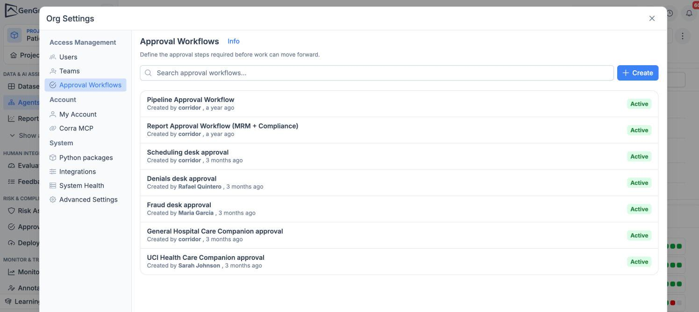
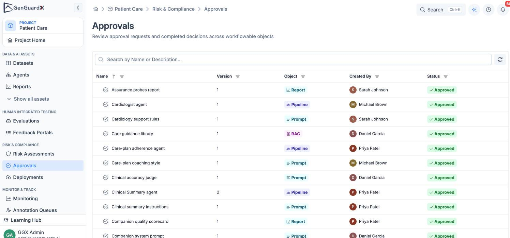
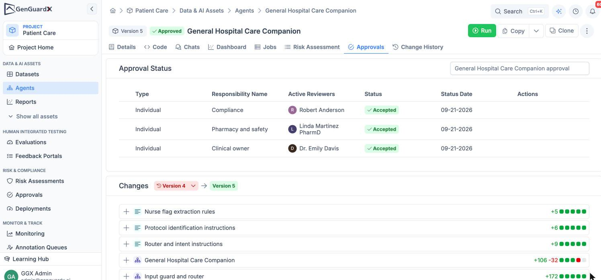

<helper-panel object='ApprovalWorkflow' location='list'>

## What is an approval workflow?

After the development of GenAI agents, it is important to have a set of review processes to ensure various committees can collectively review and approve the agent. In GGX, workflows that comprise multiple responsibilities can be created - and every responsibility is comprised of one or more reviewers. An object goes through the approval process from each of the responsibilities and reviewers.

## Why is it important?

- Creates an approval trail for model updates and changes.
- Provides clear documentation of who approved what and why.
- Ensures that only validated versions of models are deployed.
- Involves key stakeholders (developers, legal, compliance, business teams) in decision-making.
- Establishes clear ownership over AI agent governance.

## Registering approval workflows

Approval workflows are created and edited in **Org Settings** by anyone with the right authority (mainly the Admin and Master roles). Each workflow applies to the object types you choose.

1. Open the profile menu at the bottom left, choose **Org Settings**, then **Approval Workflows**.
2. Click **Create**.
3. Enter a **Name**, choose the **Object Types** it applies to (for example Pipeline, Prompt, Model, RAG, Report, Global Function), add a **Description** and set the **Status** to **Active**.
4. Under **Responsibilities**, click **Add Responsibility** for each group that must sign off, for example *Clinical owner*, *Pharmacy and safety* and *Compliance*.
5. Name each responsibility and choose its **Reviewers**: anyone with approve access, or named people.
6. Click **Save**.

> **Note:** The external tools option is available when third-party tools are configured, and lets a third-party application act as a responsibility in an approval workflow.

Once registered, the approval workflow can be chosen when registering an object. The object then has to pass every responsibility before it is approved for production use.

</helper-panel>

## Following an approval

Every object that goes through a workflow is listed under **Risk & Compliance → Approvals**, with its version, type, creator and status, so reviewers can see what is waiting for them and what has been decided.

On the object itself, the **Approvals** tab shows:

- **Approval Status**: each responsibility, its active reviewers, their decision and the date.
- **Changes**: what changed since the previous version, component by component, so reviewers approve the difference rather than re-reading everything.
- **Activity Log**: every request, decision and comment.

## Attaching validation evidence

Approval is where testing meets governance. Before an object — an agent, model, judge, or report — is approved, the results of [Simulation](../simulation/) and [Comparison](../comparison/) runs over representative or **ground-truth** datasets can be attached as evidence, so reviewers see exactly how it performed and on what data. Re-running this regression set on every change is what keeps an evaluation asset trustworthy as it evolves.

External CI can participate too: the **external tools** responsibility lets a third-party application — for example a Git/CI pipeline that runs additional checks on the object's exported code — act as an approver, blocking promotion until its status checks pass.

## Keeping track of findings and limitations

Once an object is approved, it is locked. No further changes can be made to it. But sometimes, reviews are done with findings or limitations on the usage and need follow-ups.

GGX provides a flagging capability that can be used to Flag an Object (Even Post Approval) and can be created by anyone with Write access to Settings.
An object can be flagged for any reason (e.g. `NeedShadowResultsFor2Months` or `NeedRetrainIn6Months`) by any member of any Workflow that oversees objects of the same type. Similarly, a flag can be dropped (i.e., deactivated) by anyone with the authority to add the flag.

Once the flag is activated, a warning flag appears beside the object's name on the details page, indicating that the object and its assigned flags should be carefully reviewed before being used in downstream applications.
