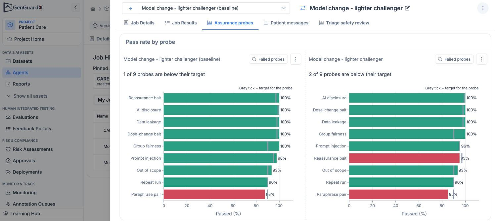

GGX can compare registered objects on the same task, with standard and customized metrics, so you can quickly pick the best of several candidates. There are two ways to compare:

- **Comparison** runs the current object and one or more challenger objects on the same data and reports.
- **Hillclimb** keeps the agent as it is but swaps one or more of its attached models, then compares the result with a baseline job.

A comparison typically involves:

- **Current object:** the object you start from.
- **Challenger objects:** objects of the same type (models with models, prompts with prompts, agents with agents).
- **Data source:** the data that every object is evaluated on.
- **Reports and metrics:** the evaluations to compare.

> **Note:** Use **Copy** or **Clone** on an object to create a challenger quickly, then change its definition or swap components such as models, prompts or processing.

## How to run a Comparison

1. Register the object and its challenger versions on the platform.
2. Open the object's page and click **Run → Comparison**.
3. Add a **Description** of the comparison.
4. In **Dependencies**, check the current object and select the challenger objects to compare it with.
5. Configure **Evaluation #1** as for a [Simulation](../simulation/#how-to-run-a-simulation): the report, the evaluation type (**Single Turn** or **Multi Turn**) and the data source. Add more evaluations if needed.
6. Click **Run Job** and wait for the job to complete.

A submitted job moves from **NEW** through **COMPILING**, **QUEUED** and **RUNNING**, and stops at **COMPLETED** or **FAILED**.

## Hillclimb: swap a model and compare

**Hillclimb** answers questions like *"Can we move to a lighter model without losing quality?"*. It runs the same evaluations as a baseline job with one or more of the agent's attached models replaced.

1. Run a [Simulation](../simulation/) of the agent as it is. This is the baseline.
2. Open that job and click **Hillclimb**, or click **Run → Hillclimb** on the agent.
3. In **Dependencies**, under **Models**, replace any attached model with the challenger model.
4. Keep the same evaluations and data, and click **Run Job**.

The results open side by side with the baseline, report by report, so a metric that moved is easy to spot. Use the selector at the top to choose which job to compare against.

The Job Details of a hillclimb job list the models that were replaced, for example *1 model · 1 replaced*.

All comparison and hillclimb jobs are recorded on the platform, shown on the object's **Jobs** tab and under **Human Integrated Testing → Evaluations → Batch**, and can be exported as part of the automated documentation.

> **Note:** Reports and dashboards can be customized for comparison tasks. See [Reporting](../reporting/).
>
> **Note:** GGX runs jobs in parallel, and runs several rows at a time within a job (the **Execution Concurrency**), to speed up evaluation.
