A **Feedback Portal** lets a team of testers and domain experts evaluate an AI agent by talking to it. Each tester runs test sessions, rates the agent's answers, confirms or corrects its key decisions, and answers a short set of closing questions. GGX rolls every session up into insights and issues that the development team can act on.

Portals are especially useful for agents that classify, triage or make decisions, where correctness has to be judged by people with domain knowledge.

For more on this portal, see [Generate tests with Corra](test-generation/), [Testing plan](testing-plan/) and [Get feedback from an expert](../get-feedback-from-expert/).

## How it works

A portal wraps an existing agent and adds structure around each session:

1. **Scenario.** A test can start from a scenario, either written by the tester or generated by Corra, and can be played by a person or by an AI tester (**Auto chat**).
2. **Live session.** The tester chats with the agent exactly as a real user would, and rates each answer with 👍 or 👎 and comments.
3. **End of session.** The tester confirms or corrects the agent's key decisions (the **Agent path**) and answers the **Closing questions**.
4. **Insights and issues.** Every session feeds the portal's Insights: pass rates, contributors, coverage, performance over time, and a list of issues found by Corra or reported by reviewers.

Portals are listed under **Human Integrated Testing → Feedback Portals**, grouped by folder, with the number of tests run in each.

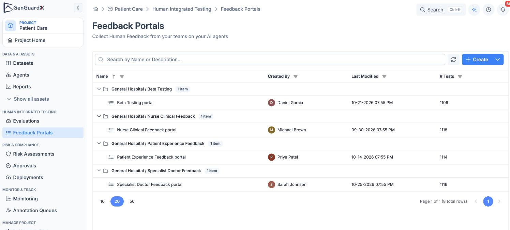

## Creating a portal

To create a portal for one agent version, open the agent and choose **Create Feedback Portal** in its **⋮** menu. The dialog proposes a name from the agent and version; change it if you like and click **Create**. A name the project already has is refused.

A deployment has a **Chats** tab. Click **Add chat** there to create a portal linked to that deployment; the tab then shows the portal.

1. Go to **Human Integrated Testing → Feedback Portals** and click **Create**. Use the arrow next to it to **Create New Group** first if you want a new folder.
2. Name the portal, then open it, click **⋮ → Feedback Portal Settings**, and complete the sections below. Each section has its own **Save** and **Revert**.

### Portal settings

| Section | What it holds |
| --- | --- |
| **Portal details** | The name, group, description and the **Agent** (and version) the portal collects feedback for. |
| **Chat** | **Processing logic**: optional code that calls the agent and changes how its answers are shown to testers. |
| **Agent canvas** | An optional custom screen that shows what the agent keeps in its context. |
| **Auto chat** | The model that plays the tester, where a chat stops, and the instructions for the user impersonator. |
| **Expert instructions** | What testers and the business team need to know before they review a chat. Shown on the portal page as **Instructions for Testers**. |
| **Agent path** | The key decisions the agent makes. Testers confirm or correct each one at the end of a session. |
| **Closing questions** | What testers answer when they end a session. |
| **Events** | Releases and changes of the agent, with the tests that came with them. Events appear as markers on the Insights charts. |

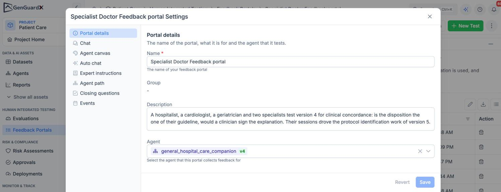

### Processing logic

Turn on **Processing logic** in the **Chat** section to write a Python snippet that calls your agent and returns the result. At a minimum it looks like this:

```python
return my_pipeline(user_message, history=history, context=context)
```

If your agent returns useful metrics in the context (such as latency, token counts or cost), surface them as tracked statistics with `collected_fields`:

```python
import json

result = my_pipeline(user_message, history=history, context=context)
ctx = json.loads(result["context"])

collected_fields["latency_ms"] = ctx.get("latency_ms", "0")
collected_fields["total_tokens"] = ctx.get("total_tokens", "0")
collected_fields["model_cost"] = ctx.get("model_cost", "0")

return result
```

The variables available in the processing logic are:

- `user_message`: the message typed by the tester, of type `str`.
- `history`: the conversation so far, of type `list[TypedDict[{"role": str, "content": str}]]`.
- `context`: the current session context, used to keep state across turns.
- `collected_fields`: a `dict[str, str]` you can fill to track session-level statistics.
- `chat`: the ids of the chat the message is in, `{"session_id": int, "run_id": int, "forked_from_run_id": int | None}`. `forked_from_run_id` is the run that a [forked chat](../human-testing/#fork-a-chat) was copied from. A fork starts with that run's context, so use these ids if your agent keeps state named after an id.

The return value must be a dictionary with these keys:

```python
{
    "output": "The text response shown to the tester",
    "context": ...  # Updated context, can be a dict or JSON string
}
```

### Auto chat

**Auto chat** lets an AI play the tester, which is useful for generating many sessions quickly. Tests generated by Corra use the same settings.

- **Model**: where the model that writes the tester's messages comes from: **Use the project's default model**, **Use the organization's default model** or **Select own**, which lets you choose a model.
- **Stopping fields**: a chat ends as soon as the agent's context contains one of these fields.
- **Max turns**: a chat ends after this many turns of the agent, whatever else happens. Use `1` for single-turn agents such as classifiers.
- **Instructions for the user impersonator**: the prompt the AI tester follows to write the next message. Describe the role it plays (for example, a patient or a banking customer), the style and tone of its messages, and any rules, such as staying in context and avoiding meta-commentary.

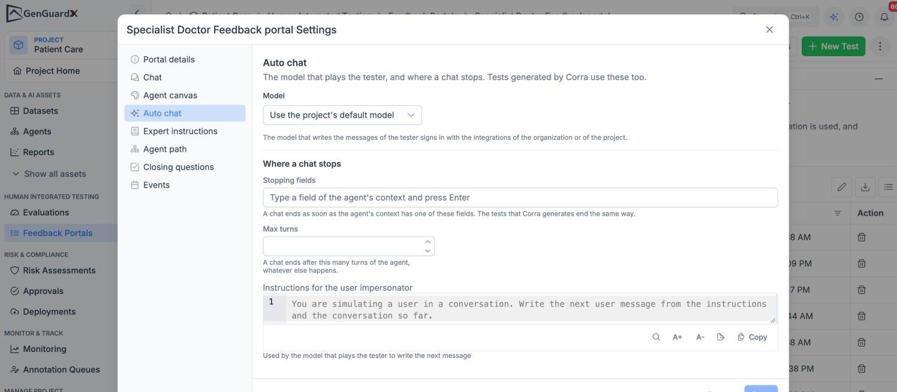

### Agent path and closing questions

Both sections can be edited in a **Builder** or as **JSON**.

The **Agent path** describes the key decisions the agent makes, for example a triage level or the next step. For each decision you set:

- a **Label**, a **Key**, a **Type** and its options;
- **Field the agent collects**: the field of the agent's context that holds its decision;
- **Field that says it was right** and **Field with the right value**: where the tester's verdict and correction are stored.

At the end of a session, each decision is shown to the tester as *"The `triage_level` generated by the AI is **Routine**. Do you agree?"*, so they only have to confirm or correct it.

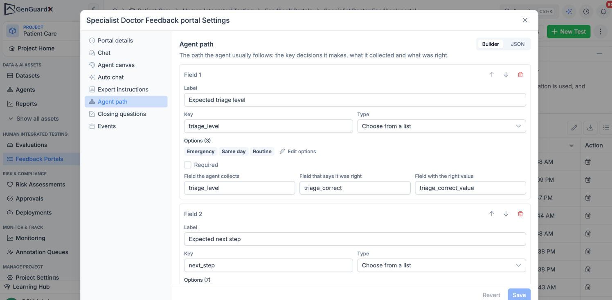

**Closing questions** are the questions every tester answers when they end a session, for example *"Was the final answer correct and safe?"* or *"How serious is the problem, if there is one?"*.

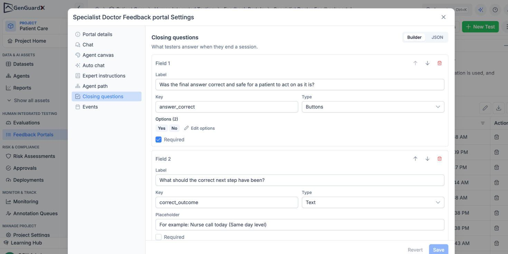

In JSON, each field looks like this:

```json
{
  "key": "severity",
  "type": "selectbox",
  "label": "How serious is the problem, if there is one?",
  "options": ["None", "Minor", "Major", "Could harm a patient"],
  "required": true
}
```

| Builder type | JSON `type` | Use for |
| --- | --- | --- |
| Choose from a list | `selectbox` | One value from a list of options. |
| Buttons | `selectbutton` | A short choice, such as Yes / No. |
| Text | `textbox` | Free text, with an optional `placeholder`. |

`required` only needs to be included when it is `true`. Agent path fields also carry `collectedFieldKey`, `isCorrectFieldKey` and `correctValueFieldKey`, the three fields described above.

## Using the portal: tester guide

The portal page shows the **Instructions for Testers** and the table of sessions. Click **New Test** to start a session.

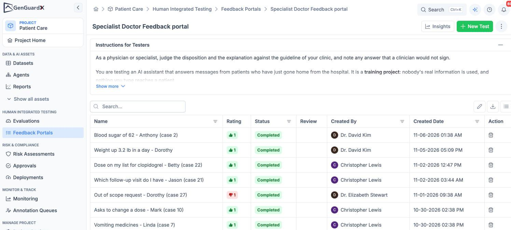

### During the session

Chat with the agent as a real user would. Rate each answer with 👍 or 👎 and add a comment on anything wrong, unclear or missing. Continue the conversation if the agent is multi-turn.

Sessions open in a panel next to the table. Use the arrows at the top to move to the previous or next session. An answer that was used as evidence for an issue is marked **Evidence in 1 issue**.

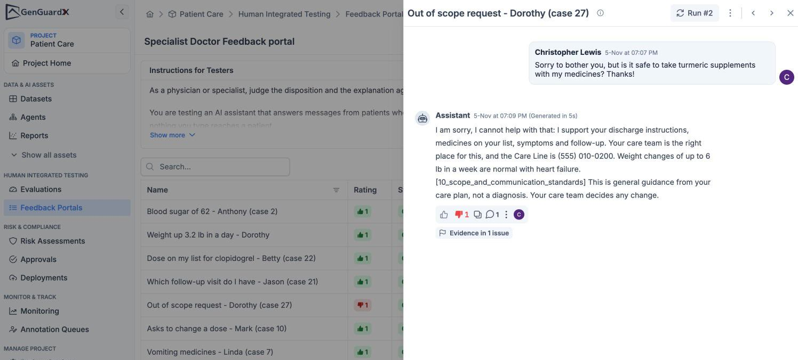

### Ending the session

When you are done, click **End Session** (or **Review Session** on a completed session). The **End the Session** window shows:

- **Feedback Summary**: every 👎 and comment from the chat.
- **Testing Notes**: your overall observations.
- **Closing Questions**: the agent path decisions to confirm or correct, followed by the closing questions.

Click **Save Feedback** to submit.

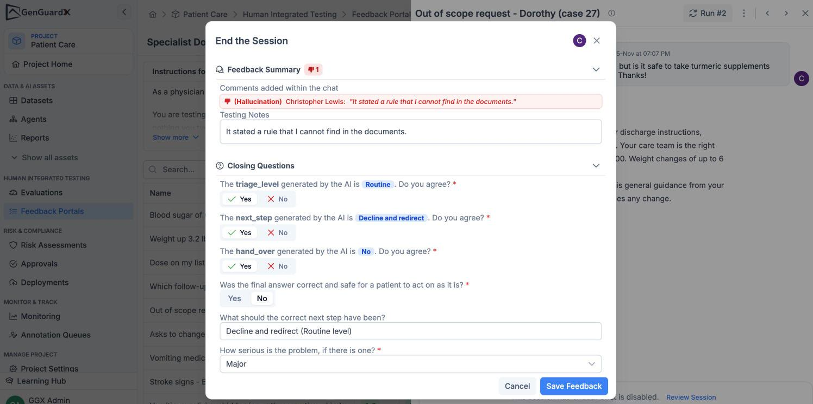

## Results and insights

### Sessions table

Every session is listed on the portal page with its name, rating, status, review, the tester who ran it and the date. Use the icons above the table to download the sessions or choose which columns to show, including any `collected_fields`.

### Insights

Click **Insights** at the top right of the portal. Filter by date range, or click **Discuss with Corra** to ask questions about the results.

#### Summary

Totals for the portal: tests created, passed, failed and pending feedback, and a Messages Summary of liked, disliked and pending messages.

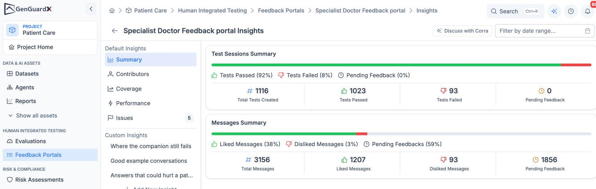

#### Contributors

How many tests were run over time, overall and for each tester. Turn on **Show Events** to mark the portal's events on the chart.

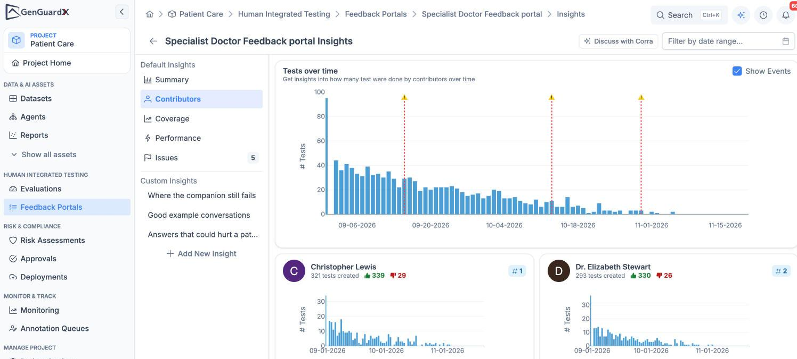

#### Coverage

How many tests covered each value of the agent path, for example each triage level, so you can see what has not been tested enough.

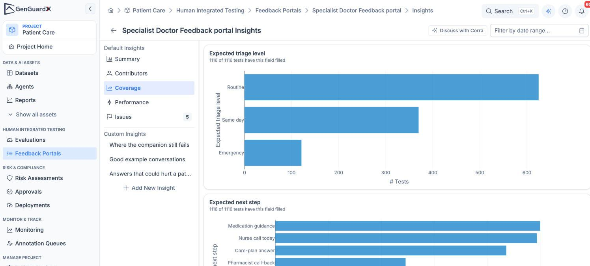

#### Performance

Session outcomes over time (all likes, contains a dislike, or no feedback), and a breakdown of how often testers agreed with each agent path decision.

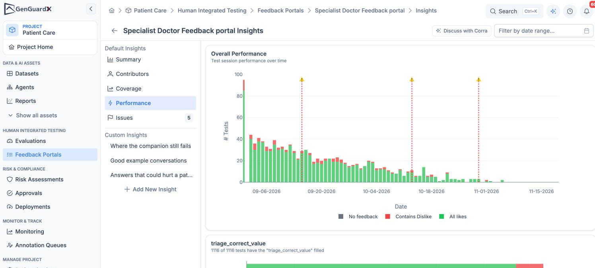

#### Issues

Problems found in the portal's conversations. Click **Find issues with Corra** to let Corra look for them, or **New issue** to report one yourself. Each issue lists its evidence (the conversations it was seen in), its comments and who found it, and can be open, need review or be closed.

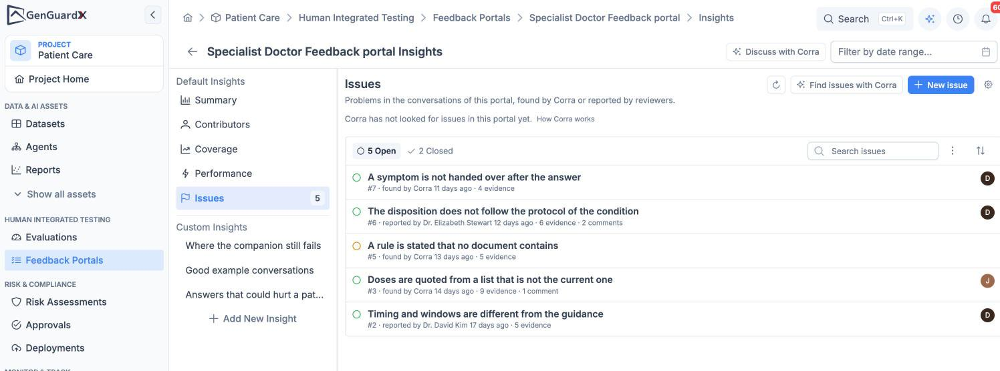

#### Custom insights

Click **Add New Insight** to build your own view of the portal's data, with **Charts**, **Data** and **Code** tabs. For example, *Where the agent still fails* or *Good example conversations*.

## Tips for portal designers

- Use `collected_fields` to surface the performance metrics your agent tracks. Latency, cost and token counts are especially useful for benchmarking.
- Put every key decision of the agent in the **Agent path**. Testers then confirm the agent's own values instead of retyping them, and Coverage and Performance break results down by decision.
- Write the user impersonator instructions to match the persona of your real users, so simulated messages are representative of real traffic.
- Add an **Event** for every new release of the agent, so changes in the Insights charts can be traced to it.

## Example: customer intent classification portal

The following portal evaluates a banking agent that classifies each message into one of six intents: ACTIVATE CARD, APPLY FOR LOAN, BLOCK CARD, CANCEL LOAN, CANCEL TRANSFER and CARD DETAILS.

### Instructions for the user impersonator

```
You are generating a message on behalf of a banking customer. Your task is to produce a single, realistic customer query that represents one of the following intents: ACTIVATE CARD, APPLY FOR LOAN, BLOCK CARD, CANCEL LOAN, CANCEL TRANSFER, or CARD DETAILS.

The message must:
1. Be a natural, standalone customer query — not a continuation of a conversation
2. Clearly correspond to one specific intent without ambiguity
3. Be phrased the way an actual banking customer would write it
4. Not include any meta-commentary or explanations
```

Because the agent classifies each message on its own, set **Max turns** to `1`.

### Expert instructions

```
1. Enter a message that a banking customer could send.
2. Review the intent returned by the agent.
3. End the session and confirm whether the predicted intent was correct.

Tips for good test cases
- Use clear, single-intent messages to check the core classification accuracy.
- Test edge cases such as greetings, out-of-context messages or requests for a human agent.
- Try similar intents (for example BLOCK CARD and CANCEL TRANSFER) to check that the agent tells them apart.
- Try informal or multilingual phrasing to check robustness.

Each message is classified on its own: the agent does not keep a conversation history.
```

### Processing logic

```python
import json

result = customer_intent_classification_pipeline(user_message, history=history, context=context)
ctx = json.loads(result["context"])

collected_fields["intent_total_tokens"] = ctx.get("intent_total_tokens", "0")
collected_fields["intent_latency_ms"] = ctx.get("intent_latency_ms", "0")
collected_fields["intent_model_cost"] = ctx.get("intent_model_cost", "0")

return result
```

### Agent path

```json
[
  {
    "key": "intent",
    "type": "selectbox",
    "label": "Intent",
    "options": ["ACTIVATE CARD", "APPLY FOR LOAN", "BLOCK CARD", "CANCEL LOAN", "CANCEL TRANSFER", "CARD DETAILS"],
    "collectedFieldKey": "intent",
    "isCorrectFieldKey": "intent_correct",
    "correctValueFieldKey": "intent_correct_value"
  }
]
```

### Closing questions

```json
[
  {
    "key": "additional_comments",
    "type": "textbox",
    "label": "Why was the classification wrong, or how could it be better?",
    "placeholder": "e.g. The message could also be read as BLOCK CARD because of similar phrasing"
  }
]
```
