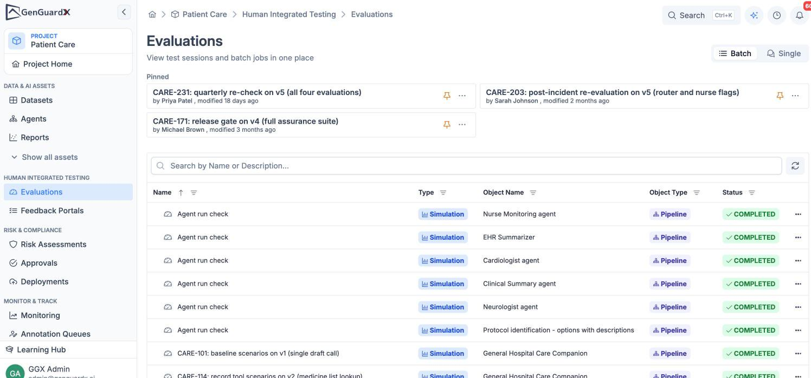
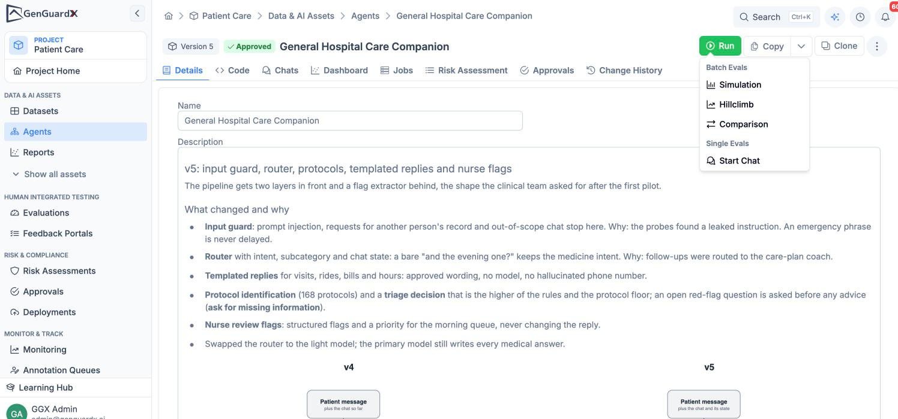

## Purpose of Evaluations

Evaluating GenAI agents is key to making sure they generate reliable, high-quality responses. Without a solid evaluation process, it is hard to tell if changes—like tweaking prompts, removing LLMs, adjusting parameters, or refining retrieval steps—are actually improving performance or breaking something. By measuring factors like relevance, hallucination rates, and latency, teams can make informed decisions about how to optimize their agents. Integrating evaluations into CI/CD pipelines ensures that every update is tested, so performance stays consistent and issues are caught early.

The quality of an evaluation depends on having a well-rounded dataset and metrics. If test cases are too limited, models might appear to perform well but fail in real-world scenarios. A diverse dataset ensures that evaluation metrics truly reflect how the model will behave in production. At the end of the day, evaluations help build trust, keeping LLM applications accurate, scalable, and dependable across different use cases.

## Choosing the Right Evaluation Method

There are two main types of evaluators for assessing LLM performance: **automated evaluation** (using LLMs or code) and **human annotations**. Each method serves a different purpose depending on the type of assessment needed.

| Method                            | How it Works                                                                                        | Best For                                                                                                                                                       |
| --------------------------------- | --------------------------------------------------------------------------------------------------- | -------------------------------------------------------------------------------------------------------------------------------------------------------------- |
| **Automated (LLM or Code-Based)** | Uses an LLM to evaluate another LLM’s output or code to measure accuracy, performance, or behavior. | - Fast, scalable qualitative evaluation.   - Reducing cost and latency.   - Automating evaluations with hard-coded criteria (e.g., code generation).     |
| **Human Annotations**             | Experts manually review and label LLM outputs.                                                      | - Evaluating automated evaluation methods.   - Applying subject matter expertise for nuanced assessments.   - Providing real-world application feedback. |

Automated evaluation is efficient for objective assessments and large-scale testing, while human annotations provide deeper insights at a higher cost. Combining both methods can ensure a balanced and reliable evaluation process.

## GenAI Evaluation Framework

Gen AI agents can introduce significant risks, making a robust evaluation framework essential for comprehensive testing and validation. Follow these structured steps to ensure effective evaluation:

| Step                                         | Description                                                                                                                                                                                  |
| -------------------------------------------- | -------------------------------------------------------------------------------------------------------------------------------------------------------------------------------------------- |
| **Identify Risks & Define Evaluation Scope** | - Assess potential risks across the agent.   - Create a comprehensive list of necessary evaluations.                                                                                   |
| **Define Evaluation Metrics**                | - Align metrics with business objectives, MRM, and FL requirements.   - Implement custom metrics as needed.   - Use GGX evaluation reports curated by GenAI and risk experts.          |
| **Prepare Evaluation Datasets**              | - Ensure datasets accurately represent the use case.   - Cover all critical business scenarios for thorough validation.   - Utilize GGX datasets curated by experts to evaluate risks. |
| **Run Evaluations**                          | - Use standard/custom reports and dashboards for structured testing.   - Interpret evaluation results to refine and enhance the agent.                                                 |
| **Compare with Challengers**                 | - Establish alternative components and agents for comparison.                                                                                                                             |

By following these steps, teams can systematically evaluate their Gen AI agents, mitigate risks, and enhance performance with data-driven insights.  
GGX provides the ability to **run evaluation jobs** for registered GenAI components.

## Where evaluations live

Every evaluation in a project is listed under **Human Integrated Testing → Evaluations**. The page has two views:

- **Batch** lists evaluation jobs (Simulation, Comparison and Hillclimb runs) with the object they ran on and their status. Pinned jobs, such as a release gate, stay at the top.
- **Single** lists human test sessions: one conversation with an agent, with its rating and who ran it.

To start an evaluation, open the agent (or prompt, model, RAG or report) under **Data & AI Assets** and click **Run**:

| Run option | What it does | Page |
| --- | --- | --- |
| **Simulation** | Runs the object on a dataset and computes one or more reports on its output. | [Simulation](simulation/) |
| **Comparison** | Runs the object and its challengers on the same data and reports, side by side. | [Comparison](comparison/#how-to-run-a-comparison) |
| **Hillclimb** | Swaps one or more attached models and compares the result with a baseline job. | [Hillclimb](comparison/#hillclimb-swap-a-model-and-compare) |
| **Start Chat** | Opens a human test session with the agent. | [Human Integrated Testing](human-testing/) |

## Introduction to Jobs

A batch evaluation runs as a **job**. Jobs are controlled by GGX and run in a dedicated, locked environment, so results are reproducible.

A job holds one or more **evaluations**. Each evaluation pairs a registered [report](reporting/) with the data it runs on, the evaluation type (**Single Turn**, one input per row, or **Multi Turn**, where a tester agent holds a full conversation with the agent) and optional metric thresholds. One job can therefore run a quality scorecard, a safety review and a set of assurance probes in a single pass.

When the job completes, GGX records every step, logs resource usage and publishes a dashboard with one tab per report. The dashboard can be shared with the team for feedback and approval, attached as evidence to a risk assessment, exported, or used for automated documentation. Every job is also listed on the object's **Jobs** tab.

## Approvals post Evaluations

The approval process is a key governance capability of the platform. After the object is fully evaluated using automated dashboard or manual tests, all the evaluation results can be shared with predefined roles within an Approval Workflow, ensuring structured reviews, feedback, and approvals for production use.

Once approved, the object is locked, preventing any modifications within the system. This guarantees the artifact remains unchanged before being exported directly to the production system.

## Standardized GGX Reports

Apart from the ability to create customized reports, GGX already has a suite of tests registered for evaluation and validation of different components of GGX. GGX Reports are crafted by a team of generative AI risk experts following thorough research and analysis. The list of reports is expanding with all the latest developments in the GenAI industry. All these reports can be used if applicable and can be maintained or forked for a specific use case.

| **Component** | **Test Name**                      | **Risk Attribute**                               | **Description**                                                                                                                                              | **Type**           | **Classification** | **Response** |
| ------------- | ---------------------------------- | ------------------------------------------------ | ------------------------------------------------------------------------------------------------------------------------------------------------------------ | ------------------ | ------------------ | ------------ |
| **Agent**  | Accuracy                           | Inaccurate Classification or Response            | Evaluate ability to correctly classify utterances or provide accurate responses to user queries.                                                             | MRM                | Yes                | Yes          |
| **Agent**  | Stability Repeated Utterances      | Output Variability                               | Evaluate the ability to produce the same classification or nearly similar responses for repetitions of the same utterance.                                   | MRM                | Yes                | Yes          |
| **Agent**  | Stability Perturbed Utterances     | Output Variability                               | Evaluate the ability to produce the same classification or similar responses across minor variations of an utterance (e.g., synonyms, grammatical mistakes). | MRM                | Yes                | Yes          |
| **Agent**  | Bias (Comparative Prompt Analysis) | Implicit / Explicit Bias                         | Evaluate bias in outputs (e.g., classification accuracy or response accuracy) based on inferred segments for gender, race, and age.                          | Fair Lending       | Yes                | Yes          |
| **Agent**  | Vulnerability                      | Prompt Injection & Prompt Leakage                | Evaluate the LLM agent’s resilience against jailbreak methods for out-of-context or ambiguous inputs.                                                     | MRM / Fair Lending | No                 | Yes          |
| **Agent**  | Toxicity                           | Hate Speech, Toxic Language, Sarcasm             | Evaluate the LLM’s avoidance of generating or repeating toxic language (e.g., inappropriate, offensive, or harmful language).                                | MRM / Fair Lending | No                 | Yes          |
| **Agent**  | Faithfulness                       | Hallucination, Inaccurate Facts                  | Evaluate adherence to provided context without hallucination.                                                                                                | MRM / Fair Lending | No                 | Yes          |
| **Prompt**    | Prompt Trust Score                 | Prompt Quality, Prompt Vulnerability and Leakage | Evaluate the prompt quality in different dimensions like Grammar, Logical Coherence, Toxicity, Bias, etc., and generate a Trust Score.                       | MRM / Fair Lending | N/A                | N/A          |
| **Prompt**    | Prompt Classification Accuracy     | Inaccurate Classification                        | Evaluate the classification accuracy of the prompt on sample data to help in the hill-climbing process.                                                      | MRM / Fair Lending | Yes                | No           |
| **LLM**       | Vocabulary Understanding           | Misinterpretation, Lack of Context Awareness     | Determine which LLM is best at defining financial services-specific terminology across seven context categories.                                             | MRM / Fair Lending | N/A                | N/A          |
| **LLM**       | Subject Understanding              | Context Misalignment, Incorrect Reasoning        | General subject understanding across Math, Science, etc.                                                                                                     | MRM / Fair Lending | N/A                | N/A          |
| **LLM**       | Reasoning Capability               | Logical Fallacies, Incorrect Inferences          | Assess LLM's capabilities such as complex reasoning, knowledge utilization, language generation, etc.                                                        | MRM / Fair Lending | N/A                | N/A          |
| **LLM**       | Toxicity Understanding             | Failure to Detect Harmful Requests               | Evaluate a model's ability to identify and classify text statements that could be considered toxic across six toxicity labels.                               | MRM / Fair Lending | N/A                | N/A          |
| **LLM**       | Toxicity Evaluation                | Hate Speech, Toxic Language, Sarcasm             | Evaluating the tendency of LLM generating toxic replies.                                                                                                     | MRM / Fair Lending | N/A                | N/A          |
| **LLM**       | Dialect Bias                       | Underrepresentation of Linguistic Variants       | Assess which LLM responds most consistently to general queries phrased in different language dialects.                                                       | MRM / Fair Lending | N/A                | N/A          |
| **LLM**       | Gender Bias with Income as Proxy   | Fair Lending Risk                                | Evaluation focuses on understanding if there is any systematic bias in assigning job titles to different genders and profiles.                               | MRM / Fair Lending | N/A                | N/A          |
| **LLM**       | Model Latency                      | Scalability Issues, User Frustration             | Determine which LLM has the best response latency performance when varying prompt and response length.                                                       | Business / Tech    | N/A                | N/A          |
| **RAG**       | Retrieval Accuracy                 | Incorrect context retrieval, hallucination       | Accuracy of the retrieved documents by the RAG system.                                                                                                       | MRM                | N/A                | N/A          |
| **RAG**       | Knowledge Evaluation               | Lack of Coverage                                 | Coverage of different scenarios and business flows in Knowledge Data.                                                                                        | Business           | N/A                | N/A          |
| **RAG**       | Validation Data Evaluation         | Lack of Coverage, Lack of Potential Scenarios    | Coverage of different scenarios and business flows in Evaluation Data.                                                                                       | MRM                | N/A                | N/A          |
