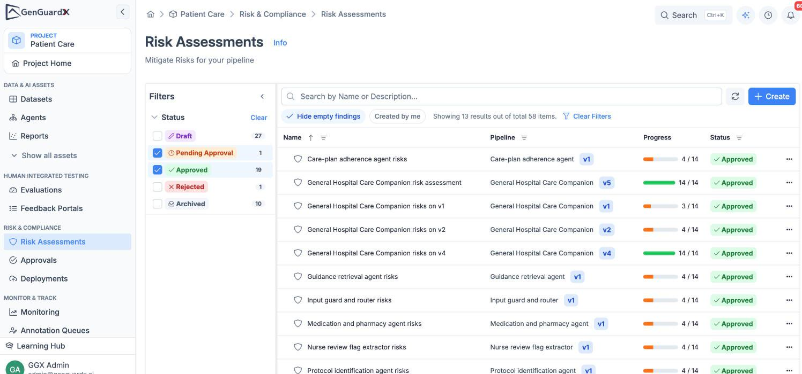
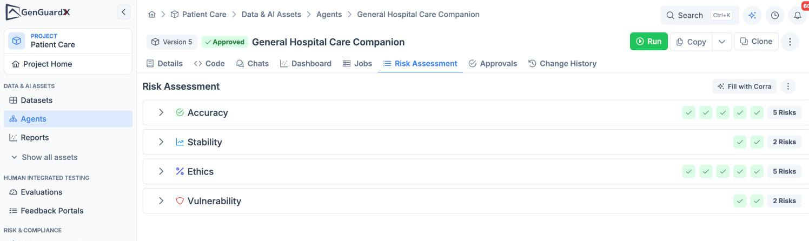
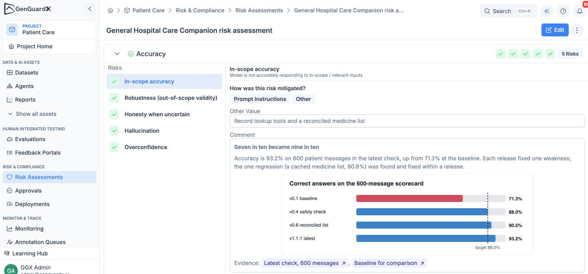

Each agent version has a **Risk Assessment** that records which risk controls apply to it, how each is met, how serious each risk is and which evidence backs the mitigation. You can also see how far the assessment covers the frameworks (laws, standards and guidance) that apply, and sign it off.

:::caution
The tier, the coverage and the framework summaries are a guide to help a review. They are not legal advice, and GGX never states that an agent complies with a law or a standard.
:::

## Where to find risk assessments

Every risk assessment in a project is listed under **Risk & Compliance → Risk Assessments**, with the agent and version it covers, its progress (how many of its risks are assessed) and its status: **Draft**, **Pending Approval**, **Approved**, **Rejected** or **Archived**. Use the filters on the left to narrow the list, and **Create** to start a new assessment.

The assessment of a specific agent version is also on the agent's **Risk Assessment** tab. Risks are grouped into categories, such as **Accuracy**, **Stability**, **Ethics** and **Vulnerability**, each showing how many of its risks are assessed.

Open a category to see its risks. For each risk, the assessment records how it was mitigated (for example **Prompt Instructions**), a comment that can include figures, the evidence behind it, and the residual risk.

## Summary, Identify and Measure

An agent's **Risk Assessment** tab has three tabs. They work on the controls of the [Risk Library](/administration/ai-policy-and-risk-library/#risk-library).

| Tab | What you do |
|-----|-------------|
| **Summary** | See how far the assessment is. It shows how many controls apply and how many are documented, with a table by Risk Library category (**Category**, **Code**, **Applies**, **Documented**). With policies on, a **Compliance** section shows each active framework with a bar of completed, to do and not applicable requirements, a percentage and the work that is left. Each item links to its control. |
| **Identify** | Answer the questions in **About this agent**, grouped as what the agent does, what it uses, who it affects and where it operates. Answers decide which controls apply. An unanswered question never hides a control. Click **Review risk controls** to see each control and switch it on or off by hand. A reason is required for a change by hand. GGX may suggest an answer, which counts as unanswered until you confirm it. |
| **Measure** | For each control that applies, write how it is met: what you did, the tests you ran, the reports. A control is documented once something is written. There is also one overview text for the whole assessment. Text saves on request or after a pause. |

Which frameworks appear in **Compliance** is set under **AI Policy**. See [AI Policy and Risk Library](/administration/ai-policy-and-risk-library/).

### Read-only when the agent version is frozen

A risk assessment is reviewed with its agent version. When the version is **Approved**, **Rejected** or **Active**, nothing in the assessment can be changed: Identify, Measure, Fill with Corra and the earlier format all become read-only, and a banner at the top says why. To continue, create a new version of the agent and copy the assessment into it. Versions in **Draft**, **Pending Approval** or **Archived** stay editable. If the version becomes approved while you have the page open, the page reloads as read-only.

### Previous format

Assessments made before the Risk Library keep their findings. Measure takes them over as the text of the controls. **Previous format** on the Measure tab opens the earlier findings screen, with the findings, severities and evidence described below. If those findings were edited after the carry-over, Measure warns that its text may not match.

That screen opens with a verdict banner: **No risks to assess**, **In progress** (some risks have no residual rating yet), **Needs attention** (a risk is rated medium or above, or an action is open) or **Ready** (every risk is mitigated and the residual risk is low).

## Findings: inherent and residual risk

Every risk has a finding with two severity ratings:

| Rating | Meaning |
|--------|---------|
| **Inherent** | How serious the risk is before any mitigation. |
| **Residual** | How serious it is after the mitigations. |

Both use the same scale: none, low, medium, high, critical. Either may be left empty. When both are set, the residual rating cannot be higher than the inherent one.

A finding also holds the mitigation method, a comment, an open action and its evidence.

## Evidence

Evidence is a record attached to a finding. It can be:

- an evaluation or monitoring job,
- an annotation queue,
- an approval,
- a link (it must start with `http://` or `https://`),
- a note.

Each record belongs to the agent version it was gathered for. When you create a new version, the risk assessment is copied and the old evidence stays visible, marked as **from an earlier version of the agent**. Such evidence is kept but does not count toward coverage until you add fresh evidence for the new version.

## Fill with Corra

**Fill with Corra** reads the agent's prompts, jobs, metrics, approvals and issues, and proposes a mitigation for each risk with the sources it used. It can also propose evidence links for assessed risks that have no recent evidence. You accept or reject each proposal. Nothing is saved until you accept it.

The **⋮** menu next to **Fill with Corra** opens the **Filler settings**, the **Risk Filling skill** that Corra follows, and **Configure**.

## EU AI Act tier

Answer a short set of yes/no questions to get a tier: **Prohibited**, **High**, **Limited** or **Minimal**. The server computes the tier when you save. Until every question is answered, the assessment shows **Not classified**, never Minimal.

:::note
The questions cover the most common cases only. A **Minimal** result means that none of these questions applied. It does not rule out other obligations, so have a compliance reviewer confirm the tier.
:::

## Frameworks and coverage

Choose which frameworks are in scope for the assessment:

| Framework | Kind |
|-----------|------|
| EU AI Act | Law |
| NIST AI RMF | Guidance |
| ISO/IEC 42001 | Standard |
| OWASP Top 10 for LLM Applications (2025) | Guidance |

Each framework lists requirements. A requirement is linked to one or more **controls**, and a control is linked to the risks of your assessment. One control can serve requirements in several frameworks. Coverage is calculated every time you open the page and is never stored.

**A control is:**

- **Met** when every risk it covers is assessed, has fresh evidence, and has a residual rating of none or low.
- **Partly met** when at least one of those risks is assessed but another condition is not met. A risk with no residual rating counts here.
- **Open** when none of its risks is assessed.

A requirement is met when all its controls are met, open when all are open, and partly met otherwise. Each framework shows how many requirements are met, partly met and open, with the reason for the first problem.

A risk marked only as not applicable needs an explanation to count as assessed.

:::note
Any fresh evidence record counts, including a note. A single note can therefore make a control **Met** when the residual risk is none or low. Review the evidence before you rely on a status.
:::

## Sign off

A person with the **Approve** permission for risk assessments can sign an assessment off once every risk is assessed. A signed-off assessment is read only, as is any assessment whose agent version is frozen (see above). Edits, Fill with Corra, restoring a version, deleting and moving it to another project are blocked until someone chooses **Reopen**. The page shows who signed it off and when.

- A copy for a new agent version never comes signed off.
- Deleting an agent version whose assessment is signed off is refused until the assessment is reopened.
- **Approve** is part of the Manage role. To give it to another role, open the role in the project settings and grant Approve on risk assessments. Roles in projects that already exist do not get it automatically.

## Related

- [AI Policy and Risk Library](/administration/ai-policy-and-risk-library/)
- [Approval Workflows](/evaluate-and-approve/approval-workflows/)
- [Agents: risk assessment tab](/register-and-refine/inventory-management/pipelines/#agent-risk-assessment)
