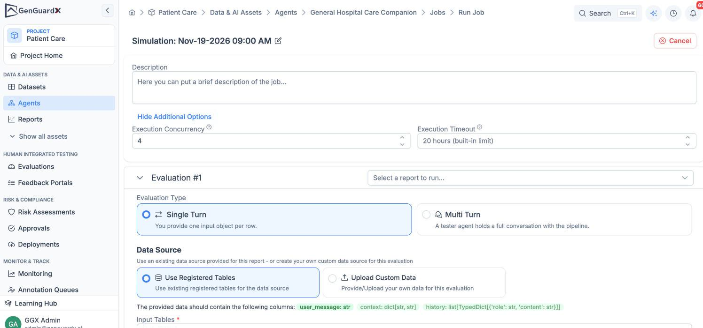
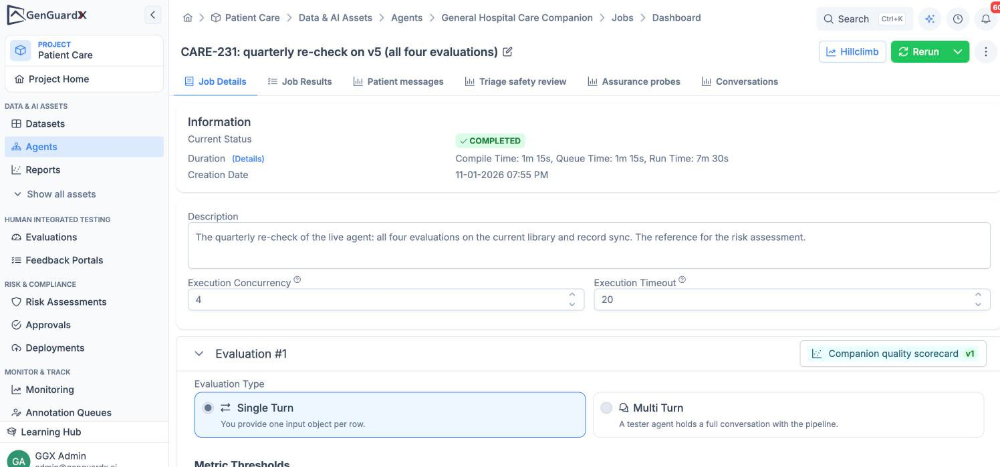
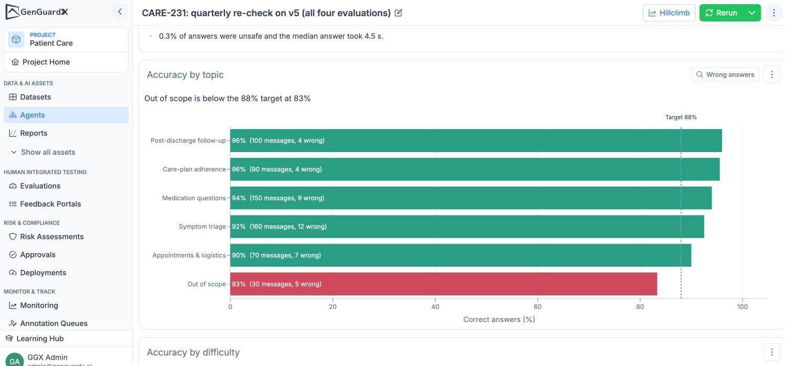

A **Simulation** is the most common type of evaluation. It runs a registered object (an agent, model, RAG or prompt) on a dataset and computes one or more reports on its output.

A simulation job holds:

- **Current object:** the object being tested, at the version you open it from.
- **Evaluations:** one or more reports to compute, each with its own data source and type.
- **Data source:** the registered tables, or uploaded data, that the object runs on.
- **Metric thresholds:** optional lower and upper limits for each metric of a report, which colour the results green or red.

## How to run a Simulation

1. Open the object under **Data & AI Assets** (for example **Agents**) and click **Run → Simulation**.
2. Rename the job if you like, and add a **Description** of what the run checks.
3. Optionally, open **Show Additional Options** to set the **Execution Concurrency** (how many rows run at once) and the **Execution Timeout**.
4. In **Evaluation #1**, select the report to run.
5. Choose the **Evaluation Type**:
    - **Single Turn**: one input per row of the data.
    - **Multi Turn**: a tester agent holds a full conversation with the agent.
6. Choose the **Data Source**:
    - **Use Registered Tables**: pick one or more registered tables under **Input Tables**.
    - **Upload Custom Data**: provide your own data for this evaluation.

    The form lists the columns the data must contain, for example `user_message`, `context` and `history` for a chat agent.
7. Click **Add Additional Evaluation** to run more reports in the same job, then click **Run Job**.

A submitted job starts in the **NEW** status and moves through **COMPILING**, **QUEUED** and **RUNNING** before it stops at **COMPLETED** or **FAILED**.

## Reading the results

The job page has a **Job Details** tab, a **Job Results** tab and one tab for each report. **Job Details** shows the status, the compile, queue and run times, and the full configuration of every evaluation, so anyone can see exactly what was run and on which data.

Each report tab is a dashboard of figures. Figures can carry a target line and a drill-down button that lists the rows behind a number.

From the job page you can:

- **Rerun** the job with the same configuration, for example on a new version of the object.
- **Hillclimb**: swap one of the attached models and compare against this job. See [Hillclimb](../comparison/#hillclimb-swap-a-model-and-compare).
- **Compare with other Simulation** (in the **⋮** menu): open this job side by side with another run.
- Pin the job so that it stays at the top of the **Evaluations** page and the object's **Jobs** tab.

All simulation jobs are recorded on the platform, listed under **Human Integrated Testing → Evaluations → Batch** and on the object's **Jobs** tab, and can be exported as part of the automated documentation.

> **Note:** Reports and dashboards can be customized for simulation tasks. See [Reporting](../reporting/).

## Validating an evaluator

Simulation is also how you check that an *evaluator* can be trusted. An LLM-as-a-judge is itself a registered model, so you can run it over a **ground-truth dataset** and compare its verdicts against the known answers — computing classification metrics just as you would for any model. The same applies to a whole report: run it on labelled data with expected outputs and confirm the numbers and visuals come out as intended before relying on it in monitoring. These runs can then be attached to the object's [Approval Workflow](../approval-workflows/) as validation evidence.
