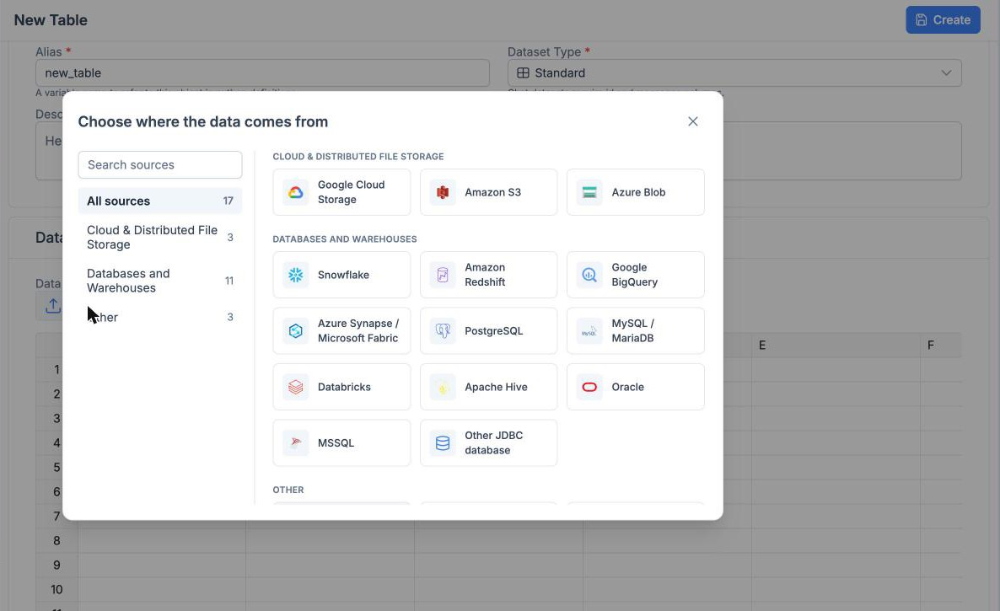

A dataset in GGX reads from a source: a warehouse, a database, or files in cloud storage. GGX supports the sources below. Warehouse, database and storage connections are set up once as an integration, then reused by every dataset that reads from that source.

## Supported sources

| Group | Sources |
| --- | --- |
| Cloud and distributed file storage | Amazon S3, Google Cloud Storage, Azure Blob |
| Databases and warehouses | Snowflake, Amazon Redshift, Google BigQuery, Azure Synapse / Microsoft Fabric, PostgreSQL, MySQL / MariaDB, Databricks, Apache Hive, Oracle, MSSQL, Other JDBC database |
| Other | File Upload, Local File Path, Custom Logic |

Databricks keeps its own setup; see [Databricks Unity Catalog](../databricks-unity-catalog/). File Upload, Local File Path and Custom Logic need no integration. See [Datasets](../../../register-and-refine/inventory-management/table-registry/) for how to register a dataset from each source.

## Set up a connection

1. Open **Org Settings → Integrations** and select the source. An organization administrator sets the default connection here.
2. Fill in the fields (see below). Secrets such as passwords and keys are stored encrypted and are never shown again. Leave a secret empty when editing to keep the saved value.
3. Click **Test connection**, then **Save**.

A project can use its own connection instead. In the project's settings, open the same source and clear **Inherit from Org Settings**.

## Install the driver

GGX does not ship the client libraries for these sources. Install the one your source needs before you test a connection or read a dataset:

1. Open **Settings → System → Python packages** (visible to organization administrators). A project has its own **Python packages** page for project-level packages.
2. Search for the package and add it.
3. Return to the source and click **Test connection**.

The connection dialog shows which package the source needs. If it is missing, the test and dataset previews report an instruction such as "Install psycopg[binary] from Settings > Python Packages to read from PostgreSQL".

| Source | Package to install |
| --- | --- |
| Snowflake | `snowflake-connector-python` |
| Amazon Redshift | `redshift-connector` |
| Google BigQuery | `google-cloud-bigquery` |
| Azure Synapse / Microsoft Fabric | `mssql-python` |
| PostgreSQL | `psycopg[binary]` |
| MySQL / MariaDB | `pymysql` |
| Oracle | `oracledb` |
| MSSQL | `pymssql` |
| Apache Hive | `pyhive[hive_pure_sasl]` |
| Other JDBC database | `jaydebeapi` and `JPype1` |
| Amazon S3 | `boto3` |
| Google Cloud Storage | `google-auth` and `requests` |
| Azure Blob | `adlfs` |

### Organization and project packages

- At the organization level, the page is described as managing "Python packages inherited by all projects".
- At the project level, packages are added to that project's environment and are used by code runs and simulations.
- Use the search box and the **Added packages** filter to find packages. **Indexes** sets the package indexes to use.
- In a project, **Update All** opens an **Update packages** dialog that looks up the latest releases of the installed packages. Choose which updates to apply.

## Connection fields

Fields marked optional can be left empty.

| Source | Login methods | Main fields |
| --- | --- | --- |
| Snowflake | Key pair, Password, OAuth token | Account identifier, User, Warehouse (optional), Role (optional), Database (optional), Schema (optional) |
| Amazon Redshift | Database user and password, IAM access key | Host, Port (optional, default 5439), Database, AWS region (optional). IAM also takes Cluster identifier or Serverless workgroup |
| Google BigQuery | Service account key, Workload identity federation | Project ID, Location (optional), Default dataset (optional), Credentials (JSON) |
| Azure Synapse / Microsoft Fabric | Microsoft Entra service principal, SQL user and password | SQL endpoint, Database, Port (optional) |
| PostgreSQL | User and password | Host, Port, Database, User, Password, SSL mode and certificates (optional) |
| MySQL / MariaDB | User and password | Host, Port, Database, User, Password, TLS mode (optional), CA certificate (optional) |
| Oracle | User and password | User, Password, then Host, Port, Service name and Protocol, or a Connect string (DSN) |
| MSSQL | SQL login and password | Host, Port, Database, User, Password, Encrypt the connection (optional), CA certificate (optional) |
| Apache Hive | LDAP, Custom, None, NOSASL | Host, Port, Database (optional), User, Password (LDAP and Custom), Use TLS (optional) |
| Other JDBC database | User and password (optional) | JDBC URL, Driver class, Driver jar path, Properties (optional) |
| Amazon S3 | Access key, Assume an IAM role, None (public bucket) | AWS region, Endpoint URL, URL style, Test path (all optional) |
| Google Cloud Storage | Service account key, Workload identity federation | Project ID (optional), Credentials (JSON), Test path (optional) |
| Azure Blob | Account key, SAS token, Microsoft Entra service principal, Connection string | Storage account, Endpoint suffix (optional), Test path (optional) |

Notes:

- Endpoint URL on Amazon S3 lets you point at an S3-compatible store.
- Other JDBC database needs a Java runtime and the driver `.jar` file on the machine that runs code. Prefer the dedicated source when GGX has one.
- Oracle databases that need a wallet are not supported.

## Where tables are addressed

When you register a dataset from a database or warehouse source, choose **Table path** or **SQL query**. The path format depends on the source, for example `DATABASE.SCHEMA.TABLE` for Snowflake and `PROJECT.DATASET.TABLE` for BigQuery. Storage sources take a file location such as `s3://bucket/path/file.parquet`, `gs://bucket/path/file.parquet` or `abfss://container@account.dfs.core.windows.net/path/file.parquet`. See [Datasets](../../../register-and-refine/inventory-management/table-registry/).
