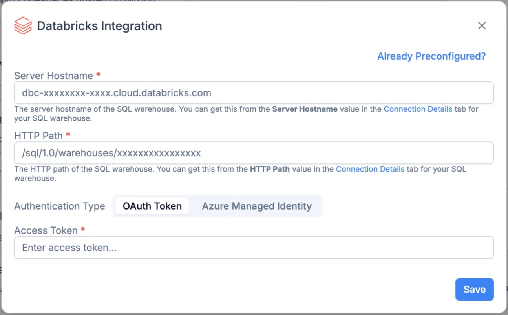

Connect a Databricks SQL warehouse to GGX, then register selected data as a dataset for evaluation and analysis. Unity Catalog controls which catalogs, schemas, and tables GGX can access.

**GGX treats your Databricks warehouse as read-only and does not write to it.** Connecting the integration does **not create a full copy of your Databricks data**. GGX reads the table or query results selected for a dataset; those results can be loaded into GGX for processing and used to produce evaluation outputs and reports.

## Service Account in Databricks

Use a dedicated **service account (SA)** for GGX, represented by a Databricks **service principal**, rather than an individual's account. For Azure Managed Identity authentication, assign the managed identity to the Databricks workspace and grant it the same data access.

Have a Databricks administrator assign the identity to the workspace, enable its **Databricks SQL access** entitlement, and grant access only to the required data. See [SQL warehouse access settings](https://docs.databricks.com/aws/en/admin/sql).

| Permission | Scope | Purpose |
| --- | --- | --- |
| `CAN USE` | The SQL warehouse used by GGX | Execute dataset reads on the warehouse. |
| `USE CATALOG` | Each required catalog | Access the containing catalog. |
| `USE SCHEMA` | Each required schema | Access the containing schema. |
| `SELECT` | Each required table or view | Read the selected data. |
| `EXTERNAL USE SCHEMA` | Each schema accessed through external Unity Catalog APIs | Allow external engines to access its data. |

For example, an administrator can grant the Unity Catalog privileges below. Replace the catalog, schema, table, and service principal application ID with your own values; configure warehouse access separately.

```sql
GRANT USE CATALOG ON CATALOG evaluation TO `<service-principal-application-id>`;
GRANT USE SCHEMA ON SCHEMA evaluation.approved TO `<service-principal-application-id>`;
GRANT SELECT ON TABLE evaluation.approved.test_cases TO `<service-principal-application-id>`;
GRANT EXTERNAL USE SCHEMA ON SCHEMA evaluation.approved TO `<service-principal-application-id>`;
```

`EXTERNAL USE SCHEMA` applies to external Unity Catalog access; SQL warehouse queries use the warehouse and read permissions above. For external access, a metastore administrator must also enable **External data access**, and the catalog owner must grant `EXTERNAL USE SCHEMA` explicitly. It is excluded from `ALL PRIVILEGES`. See [Databricks external access requirements](https://docs.databricks.com/aws/en/external-access/admin).

Keep the service account's grants read-only. GGX does not need `MODIFY`, `CREATE TABLE`, or ownership privileges for dataset reads. Scope `SELECT` to approved tables or views, including all sources referenced by a SQL query.

## Connect Databricks in GGX

1. In Databricks, open your SQL warehouse's **Connection Details** and copy its **Server Hostname** and **HTTP Path**.
2. In GGX, open **Org Settings → Integrations** from the profile menu.
3. Under **Data Providers**, select **Databricks**.
4. Enter **Server Hostname** and **HTTP Path**, then choose an authentication type as described below.
5. Enter the matching credential and click **Save**.



### Authentication options

| Authentication type | What to configure | When to use it |
| --- | --- | --- |
| **OAuth Token** | Enter the service account's access token in **Access Token**. | Token-based access to the configured Databricks workspace. |
| **Azure Managed Identity** | Enter the **Managed Identity Client ID**, or use **Autodetect** to detect the identity of the VM running GGX. If several identities are available, select the intended one. | GGX runs on Azure infrastructure with a managed identity available to access Azure Databricks. |

For **OAuth Token**, obtain the token through your organization's approved service principal OAuth flow. The form accepts an access token, rather than a client ID and client secret. Replace the saved token when it expires. See [Databricks service principal OAuth](https://docs.databricks.com/aws/en/dev-tools/auth/oauth-m2m).

For **Azure Managed Identity**, the identity must be available to the GGX runtime and assigned to the Databricks workspace with the permissions listed above. See [Azure managed identity authentication](https://learn.microsoft.com/en-us/azure/databricks/dev-tools/auth/azure-mi).

## Register a Databricks dataset

Saving the integration makes the connection available to **Datasets**. Register each table or query that you want to use:

1. Open **Data & AI Assets → Datasets** and click **Create**.
2. Enter the dataset's name, alias, group, and description.
3. In the **Location** source selector, choose **Databricks**. If the connection is missing, use **Connect now** to configure it.
4. Choose how GGX should read the data:
   - **Table path:** Enter the full `catalog.schema.table_name`, for example `evaluation.approved.test_cases`.
   - **SQL query:** Enter a read-only `SELECT` query to select columns, filter rows, or join approved tables. The configured Databricks SQL warehouse executes the query.
5. Save the dataset, then use **Fetch Columns** to load its column names and types. Check the data through **Explore Data** before using it in a job.

For example, use **SQL query** to read only the cases required for an evaluation:

```sql
SELECT case_id, prompt, expected_answer
FROM evaluation.approved.test_cases
WHERE evaluation_ready = true
```

A table path reads the selected table; a SQL query lets you limit the data returned. Neither option duplicates the entire warehouse. Record the source owner and table version or query definition with your evaluation evidence so you can reproduce a run when the source changes.

## Use the dataset in GGX workflows

Once registered, reuse the dataset wherever GGX lets you select a dataset as a data source:

- **[Simulations](../../../evaluate-and-approve/simulation/):** Select it in **Data Sources** to test a Model, Prompt, RAG, or Agent and run evaluation reports.
- **[Comparisons](../../../evaluate-and-approve/comparison/):** Use the same dataset for the current object and its challengers to compare results on shared inputs.
- **[Quality Checks](../../../register-and-refine/inventory-management/table-registry/#what-is-a-quality-check):** Link the dataset to a quality check to profile the selected data and identify invalid or missing values.
- **[Approval workflows](../../../evaluate-and-approve/approval-workflows/):** Attach the resulting evaluation jobs and reports as evidence for review.

GGX keeps the resulting evaluations and lifecycle evidence in GGX. It does not write evaluation results or dataset edits back to Databricks. When source data changes, rerun the relevant evaluations and retain the source version with their results.

## Other data formats and custom integrations

Other data formats and providers can be supported through **custom integrations**. Use **Custom Logic** in [Datasets](../../../register-and-refine/inventory-management/table-registry/) when a source needs a custom reader. The registered dataset can then be reused in the same evaluation workflows.
