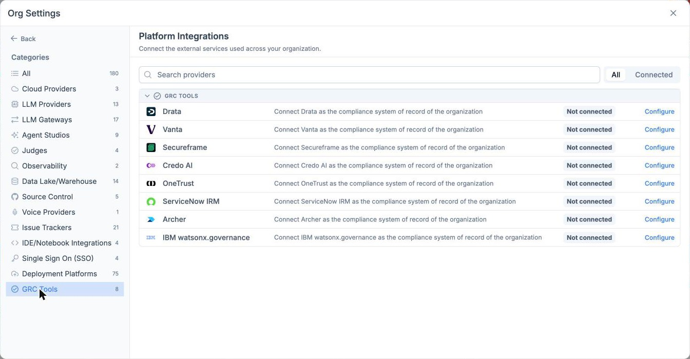
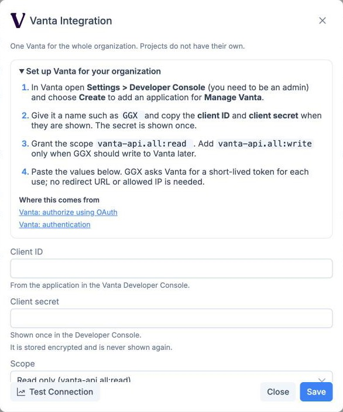

A GRC tool is the system where your compliance team keeps policies and controls. GGX connects to it so the compliance system and the AI lifecycle can work from the same records.

An organization has one GRC system, so these tools are set up once for the whole organization. Projects do not have their own, and Project Settings does not list them.

## Current status

Today you can save the connection and test it. GGX declares two capabilities for every tool, **Import AI policy** and **Map controls**, but no screen uses them yet. Connecting a tool now prepares the organization for them.

## Supported tools

| Tool | Sign-in | What you enter |
| --- | --- | --- |
| Vanta | OAuth 2.0 client credentials | Client ID, client secret, scope (read only or read and write), and region (commercial or government) |
| Drata | OAuth 2.0 client credentials, or API key | Sign in with, region (United States, Europe, or Asia Pacific), then token URL, audience, client ID, and client secret for OAuth, or an API key |
| Secureframe | API key and secret | Region (United States or United Kingdom), API key, and API secret |
| Credo AI | API key | API key, tenant, and an optional base URL |
| OneTrust | OAuth 2.0 client credentials | Tenant host, client ID, and client secret |
| ServiceNow IRM | OAuth 2.0 client credentials | Instance URL, client ID, and client secret |
| Archer | Session login | Base URL, instance name, user name, optional user domain, and password |
| IBM watsonx.governance | IBM Cloud API key | IBM Cloud API key and region (Dallas, London, Frankfurt, Sydney, or Tokyo) |

ServiceNow IRM is separate from the ServiceNow issue tracker. They are different integrations with their own OAuth applications.

## How to connect

1. Open **Org Settings → Integrations** from the profile menu and find the **GRC Tools** group.
2. Select the tool. The dialog opens with a collapsible **Set up** guide for that tool: numbered steps and links to the vendor's documents. Follow it in the vendor's product to create the credentials.
3. Enter the values from the table above.
4. Select **Test Connection**. GGX makes a real sign-in request to the vendor. The test passes only when the vendor answers with a token or a successful response.
5. Select **Save**.

## Notes

- Secrets are write-only. GGX encrypts them and never shows them again. Leave a secret empty to keep the saved one.
- URLs must use HTTPS and carry no credentials.
- Use a dedicated integration user or application in the vendor product, with the least access it needs.
- **Remove** deletes the saved configuration.
- Only people who can change organization settings can edit these tools.
