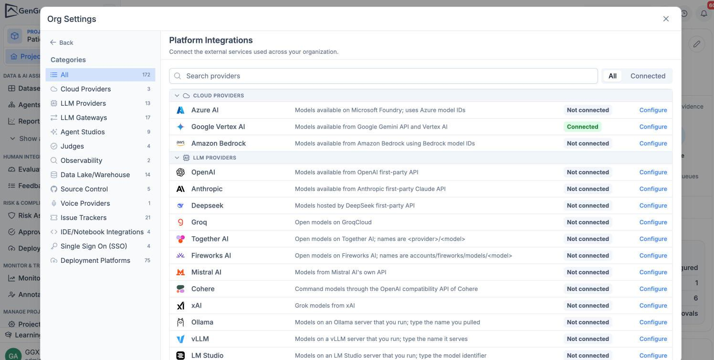

import IntegrationShowcase from "../../../components/IntegrationShowcase.astro";

GGX is built with extensibility in mind and supports a wide range of integrations that plug into your existing workflows and tools.

Integrations are set up once for the organization in **Org Settings → Integrations** (open **Org Settings** from the profile menu). The **Platform Integrations** page lists more than 170 services by category, each with its status and a **Configure** link. Credentials you enter there become environment variables that models, agents and reports can use. See [Setting up Integrations](llm-providers/) for the steps.

## All integrations

Every integration below has its own page: what it does in GGX and how to connect it.

<IntegrationShowcase />

## Observability and closed-loop monitoring

AI observability platforms are valuable because they collect production traces, scores, feedback, and alerts. GGX makes those signals operational across the AI lifecycle.

Traces from tools such as LangSmith, Arize Phoenix, Langfuse, Humanloop, and Datadog can be connected to GGX. Once connected, GGX can run automated judges and route selected interactions to human review. Positive reviews can be promoted into ground truth. Negative reviews can become bugs or findings. Repeated issues can be grouped into common failure categories.

This reduces the review funnel and makes monitoring useful beyond dashboards. Monitoring evidence starts to power better datasets, better judges, clearer approval evidence, and more targeted fixes before the next deployment.
