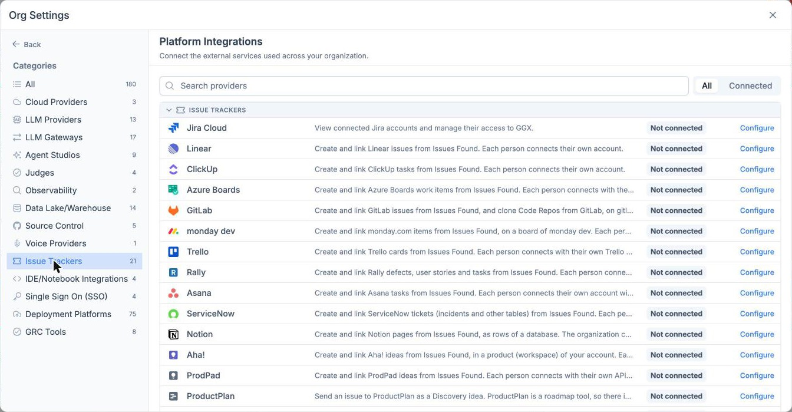

When review finds a problem, GGX can turn the issue into a ticket in your tracker, link existing tickets, and keep each ticket's status visible next to the issue. Configure a tracker in **Org Settings → Integrations → Issue trackers**. To post issues into a chat channel instead, see [Issue channels](../issue-channels/).

## How people connect

Each tracker uses one of three connection styles:

- **Sign-in (OAuth).** An administrator saves the tracker's app credentials once, and each person signs in from **My Account → Integrations**. Tickets are created as that person. The setup dialog shows the callback URL and scopes to copy into the tracker.
- **Personal token.** Each person pastes their own API key or token. A personal token acts as its owner and is recorded in the tracker under that person.
- **Organization connection.** An administrator connects once, and nobody connects individually (Notion and Smartsheet).

Where a tracker offers sign-in and a personal token (Linear, ClickUp, GitLab, monday dev, Asana), sign-in is the default and personal tokens are off until an administrator ticks **Let people connect with a personal API token**. For Rally, ProdPad, ProductPlan, and Hive, which have only tokens, nobody can connect until that box is ticked.

GGX matches a ticket's status to its own issue statuses (Needs triage, Open, Resolved, Won't fix, Duplicate) by name. Each page says how the tracker's states are read.

| Integration | Connection | What it does |
| --- | --- | --- |
| [Jira Cloud](jira-cloud/) | Sign-in | Create and link Jira tickets with an Atlassian sign-in. |
| [GitHub Issues](github-issues/) | GitHub connection | Create and link GitHub issues, including GitHub Enterprise Server, using the connection for Code Repos. |
| [GitLab Issues](gitlab-issues/) | Sign-in or token | Create and link GitLab issues on gitlab.com or a self-managed server. |
| [Linear](linear/) | Sign-in or token | Create and link Linear issues in a team. |
| [ClickUp](clickup/) | Sign-in or token | Create and link ClickUp tasks in a List. |
| [monday dev](monday-dev/) | Sign-in or token | Create and link items on a monday dev board. |
| [Asana](asana/) | Sign-in or token | Create and link Asana tasks in a project. |
| [Azure Boards](azure-boards/) | Token | Create and link work items with a personal access token. |
| [Rally](rally/) | Token (admin allows) | Create and link defects, user stories, and tasks. |
| [Trello](trello/) | Token | Create and link cards in a board and list. |
| [ServiceNow](servicenow/) | Sign-in | Create and link incidents and other table records. |
| [Basecamp](basecamp/) | Sign-in | Create and link to-dos in a to-do list. |
| [Zoho Sprints](zoho-sprints/) | Sign-in | Create and link items in a project backlog. |
| [Perforce Helix ALM](helix-alm/) | Token | Create and link issues on your own Helix ALM server. |
| [Aha!](aha/) | Token | Create and link ideas with an API key. |
| [ProdPad](prodpad/) | Token (admin allows) | Create and link ideas with an API key. |
| [ProductPlan](productplan/) | Token (admin allows) | Send issues as Discovery ideas with an API token. |
| [Hive](hive/) | Token (admin allows) | Create and link actions with an API key. |
| [Notion](notion/) | Organization | Create and link pages as rows of a database. |
| [Smartsheet](smartsheet/) | Organization | Create and link rows of a sheet. |
