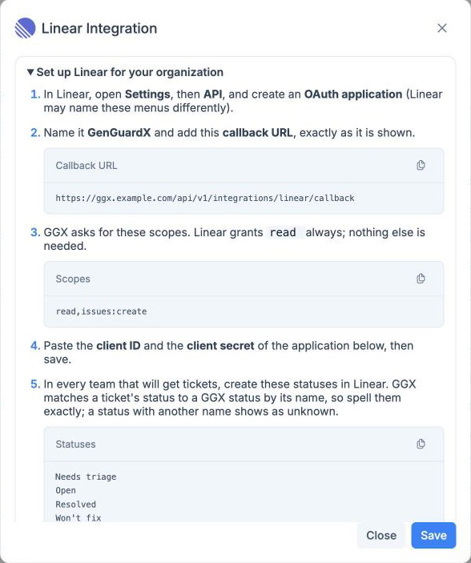

[Linear](https://linear.app/) is an issue tracker for software teams. GGX uses it to turn issues found in annotation queues and feedback portals into Linear issues.

## What it does in GGX

- Create a Linear issue from a GGX issue (Issues Found), in a team you pick.
- Link an existing issue by identifier (for example `ENG-123`) or URL.
- Show each linked issue's status and refresh it in the background and on demand.
- Issues are created as the person who connected.

## How to connect

1. An administrator registers an OAuth application in Linear (**Settings**, then **API**) and saves its client ID and client secret in **Org Settings → Integrations → Issue trackers → Linear**. The dialog shows the callback URL and scopes to copy into Linear.
2. Each person opens **My Account → Integrations → Linear** and signs in with Linear.
3. Optional: an administrator can tick **Let people connect with a personal API token** in the same dialog. People can then paste a personal API key from their Linear account settings (Security & access) instead. This is off by default, because a personal token acts as its owner and does not expire until revoked.

## Notes

- GGX matches a ticket's status to its own issue statuses (Needs triage, Open, Resolved, Won't fix, Duplicate) by name. To track them, create statuses with those names in Linear. Other statuses are shown as written.
- If an administrator turns personal tokens off later, people connected with a token see a message asking them to reconnect with sign-in when they can.
