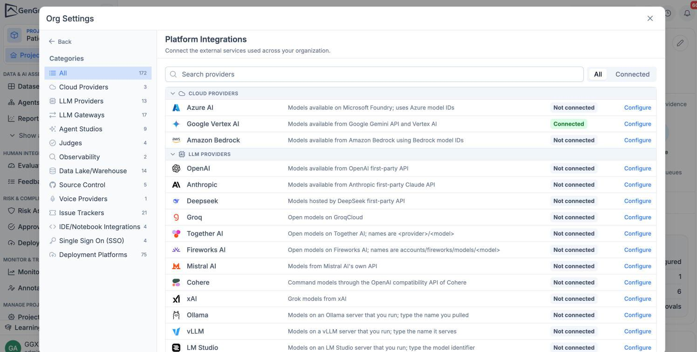
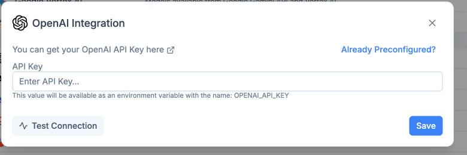

Set up integrations with the services that provide LLMs as an API. Configure your credentials once, and every authorized user can call those models from the platform.

## Getting started

Open **Org Settings → Integrations** from the profile menu. The **Platform Integrations** page lists every supported service, grouped by category, with its status (**Connected** or **Not connected**). Search for a provider, or switch to **Connected** to see only the integrations that are set up.



To set up a provider:

1. Click **Configure** next to it.
2. Enter its credentials. Each field shows the name of the environment variable it creates.
3. Click **Test Connection**, where available, to check the credentials.
4. Click **Save**.



If the credentials are already provided by the environment that runs GGX (for example, set by your administrator at deployment), click **Already Preconfigured?** instead of entering them.

Credentials can also be set for a single project, in the project's integrations, when a project needs its own keys.

## Cloud providers

| Provider | What to enter | Environment variables |
| --- | --- | --- |
| **Azure AI** (models on Microsoft Foundry) | API key and API endpoint | `AZURE_OPENAI_API_KEY`, `AZURE_ENDPOINT` |
| **Google Vertex AI** (Gemini API and Vertex AI) | API key | `GOOGLE_API_KEY` |
| **Amazon Bedrock** | Choose **Environment Variables**, **Assume Role Provider** or **EC2 Role Based** authentication. With environment variables, enter the access key ID, secret access key, optional session token and default region. | `AWS_ACCESS_KEY_ID`, `AWS_SECRET_ACCESS_KEY`, `AWS_SESSION_TOKEN`, `AWS_DEFAULT_REGION` |

## LLM providers

| Provider | What to enter | Environment variable |
| --- | --- | --- |
| **OpenAI** | API key from platform.openai.com | `OPENAI_API_KEY` |
| **Anthropic** | API key from console.anthropic.com | `ANTHROPIC_API_KEY` |
| **Deepseek** | API key from the DeepSeek platform | `DEEPSEEK_API_KEY` |

The catalog also includes **Groq**, **Together AI**, **Fireworks AI**, **Mistral AI**, **Cohere**, **xAI**, and self-hosted model servers: **Ollama**, **vLLM** and **LM Studio**. Each form shows the fields it needs and the environment variables it creates.

## Model hubs and gateways

These services are listed under **LLM Gateways** in the catalog:

| Provider | What to enter | Environment variables |
| --- | --- | --- |
| **Hugging Face** | API token from huggingface.co/settings/tokens | `HUGGING_FACE_HUB_TOKEN` |
| **Nvidia NIM** | API key and API endpoint | `NVIDIA_API_KEY`, `NVIDIA_NIM_ENDPOINT` |
| **Github Models** | GitHub token | `GITHUB_TOKEN` |

For routing gateways such as LiteLLM, Portkey, OpenRouter, Cloudflare AI Gateway and Databricks AI Gateway, see [LLM Gateways](../llm-gateways/).

## Using environment variables

Once an integration is saved, its environment variables are available in your model code:

```python
import os

openai_key = os.getenv("OPENAI_API_KEY")
anthropic_key = os.getenv("ANTHROPIC_API_KEY")
azure_key = os.getenv("AZURE_OPENAI_API_KEY")
azure_endpoint = os.getenv("AZURE_ENDPOINT")
deepseek_key = os.getenv("DEEPSEEK_API_KEY")
google_key = os.getenv("GOOGLE_API_KEY")
hf_token = os.getenv("HUGGING_FACE_HUB_TOKEN")
github_token = os.getenv("GITHUB_TOKEN")

# AWS Bedrock credentials
aws_access_key = os.getenv("AWS_ACCESS_KEY_ID")
aws_secret_key = os.getenv("AWS_SECRET_ACCESS_KEY")
aws_session_token = os.getenv("AWS_SESSION_TOKEN")
aws_region = os.getenv("AWS_DEFAULT_REGION")
```

Never hard-code keys in model code: a missing variable means the integration is not configured for the organization or the project.

## Need help?

- Use **Test Connection** to verify your keys before saving.
- Check the provider's documentation for how to create a key.
- Make sure the key has the permissions your models need.

## More integrations

| Integration | What it does |
| --- | --- |
| [Deepseek](deepseek/) | Connect Deepseek as an LLM provider in GGX. |
| [Groq](groq/) | Connect Groq as an LLM provider in GGX. |
| [Together AI](together-ai/) | Connect Together AI as an LLM provider in GGX. |
| [Fireworks AI](fireworks-ai/) | Connect Fireworks AI as an LLM provider in GGX. |
| [Mistral AI](mistral-ai/) | Connect Mistral AI as an LLM provider in GGX. |
| [Cohere](cohere/) | Connect Cohere as an LLM provider in GGX. |
| [xAI](xai/) | Connect xAI as an LLM provider in GGX. |
| [Ollama](ollama/) | Connect Ollama as an LLM provider in GGX. |
| [vLLM](vllm/) | Connect vLLM as an LLM provider in GGX. |
| [LM Studio](lm-studio/) | Connect LM Studio as an LLM provider in GGX. |
| [Meta (Llama)](meta-llama/) | Connect Meta (Llama) as an LLM provider in GGX. |
| [TypeSafe AI](typesafe-ai/) | Connect TypeSafe AI as an LLM provider in GGX. |
