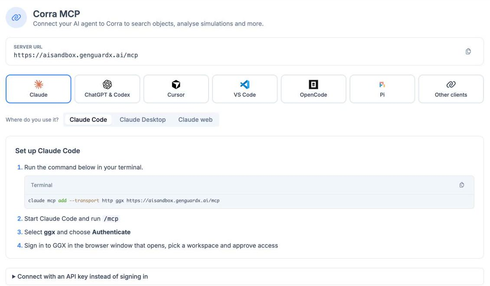

import { Tabs, TabItem } from '@astrojs/starlight/components';

Connect your AI coding client to GGX through the [Model Context Protocol (MCP)](https://modelcontextprotocol.io/). The client can then use your GGX permissions to find platform objects, consult GGX documentation, author assets, run agents, and start simulations.

## Before you begin

You need a GGX account and an instance URL that your coding client can reach. The MCP endpoint is your GGX instance URL followed by `/mcp`.

```text
https://YOUR-GGX-INSTANCE/mcp
```

To get your instance's exact URL and step-by-step setup for your client, open **Org Settings → Account → Corra MCP** from the profile menu in GGX. The page shows the server URL with a copy button, and instructions for Claude (Code, Desktop and web), ChatGPT and Codex, Cursor, VS Code, OpenCode, Pi and other clients. It also explains how to **connect with an API key instead of signing in**, for clients that cannot open a browser.



When you first use the server, your client opens a browser window so you can sign in to GGX, pick a workspace and approve access. The server only exposes data and actions that your GGX account is authorized to use.

:::caution
GGX MCP includes tools that can create, update, and permanently delete GGX objects, as well as run agents and simulations. Keep tool approvals enabled, review write actions before approving them, and connect only to GGX instances you trust.
:::

## Connect your client

<Tabs>
<TabItem label="Codex">

Add GGX from the project where you use Codex:

```sh
codex mcp add ggx --url https://YOUR-GGX-INSTANCE/mcp
```

If the browser sign-in flow does not open automatically, run `codex mcp login ggx`. Confirm the server is available with `codex mcp list`.

The Codex CLI and IDE extension share this MCP configuration.

</TabItem>
<TabItem label="Claude Code">

Choose where to save the server configuration:

<Tabs>
<TabItem label="This project">

```sh
claude mcp add --transport http ggx https://YOUR-GGX-INSTANCE/mcp
```

</TabItem>
<TabItem label="All projects">

```sh
claude mcp add --transport http --scope user ggx https://YOUR-GGX-INSTANCE/mcp
```

</TabItem>
</Tabs>

Run `claude mcp list` to verify the server. In Claude Code, run `/mcp` and complete the browser sign-in if prompted.

</TabItem>
<TabItem label="Gemini CLI">

Choose where to save the server configuration:

<Tabs>
<TabItem label="This project">

```sh
gemini mcp add --transport http ggx https://YOUR-GGX-INSTANCE/mcp
```

</TabItem>
<TabItem label="All projects">

```sh
gemini mcp add --scope user --transport http ggx https://YOUR-GGX-INSTANCE/mcp
```

</TabItem>
</Tabs>

Run `gemini mcp list` to verify the server. If sign-in is required, open Gemini CLI and run `/mcp auth ggx`.

</TabItem>
<TabItem label="OpenCode">

Choose where to save the server configuration:

<Tabs>
<TabItem label="This project">

```sh
opencode mcp add ggx --url https://YOUR-GGX-INSTANCE/mcp
```

</TabItem>
<TabItem label="All projects">

```sh
opencode mcp add ggx --global --url https://YOUR-GGX-INSTANCE/mcp
```

</TabItem>
</Tabs>

Run `opencode mcp auth ggx` to complete sign-in, then confirm the connection with `opencode mcp list`. You can also manage the server from the `/mcps` view.

</TabItem>
<TabItem label="Cursor">

Open `~/.cursor/mcp.json` for all projects, or `.cursor/mcp.json` inside one project, and add:

```json
{
  "mcpServers": {
    "ggx": {
      "url": "https://YOUR-GGX-INSTANCE/mcp"
    }
  }
}
```

Cursor asks you to sign in to GGX. Sign in and approve access. If it does not connect, open the **Output** panel and choose **MCP Logs**.

</TabItem>
<TabItem label="Pi">

```sh
pi mcp add ggx --url https://YOUR-GGX-INSTANCE/mcp
pi mcp login ggx
pi mcp list
```

The server is saved in `~/.pi/agent/mcp.json` for all projects. Add `--local` to `pi mcp add` to keep it in one project. In Pi, `/mcp` shows the status and the tools.

</TabItem>
<TabItem label="VS Code">

<Tabs>
<TabItem label="Guided setup">

Open the Command Palette and run **MCP: Add Server**. Choose **HTTP**, enter `https://YOUR-GGX-INSTANCE/mcp`, name the server `ggx`, and select either workspace or user-profile storage.

</TabItem>
<TabItem label="Workspace config">

Create `.vscode/mcp.json` in the project root:

```json
{
  "servers": {
    "ggx": {
      "type": "http",
      "url": "https://YOUR-GGX-INSTANCE/mcp"
    }
  }
}
```

</TabItem>
</Tabs>

Open Copilot Chat in Agent mode and enable GGX in the tools picker. Complete the GGX browser sign-in when prompted. Use **MCP: List Servers** to check the connection or view its output log.

</TabItem>
<TabItem label="Zed">

<Tabs>
<TabItem label="Guided setup">

Open **Settings → AI → MCP Servers**, select **Add Server**, then select **Add Remote Server**. Name the server `ggx` and enter `https://YOUR-GGX-INSTANCE/mcp`.

</TabItem>
<TabItem label="Settings JSON">

Add the GGX server to your Zed settings file:

```json
{
  "context_servers": {
    "ggx": {
      "url": "https://YOUR-GGX-INSTANCE/mcp"
    }
  }
}
```

</TabItem>
</Tabs>

Complete the GGX browser sign-in when Zed prompts you. Return to **Settings → AI → MCP Servers** and confirm that GGX has a green active status, then enable its tools in an Agent Panel thread.

</TabItem>
</Tabs>

### Claude Desktop, Claude web and ChatGPT

These clients add GGX as a custom connector or MCP server, using the server URL from **Corra MCP**.

- **Claude Desktop**: open **Settings → Connectors**, click **Add**, choose **Add custom connector**, paste the URL and click **Add**.
- **Claude web**: the **Corra MCP** page has a link that opens the **Add custom connector** window on claude.ai. Paste the URL and click **Add**.
- **ChatGPT**: open **Plugins**, click **Add**, add a custom MCP server and paste the URL. In a new chat, turn on GGX.

Sign in to GGX when asked and approve access. In Claude, turn on the tools you want under the connector.

### Connect with an API key

If your client cannot open a browser, or sign-in is blocked, connect with your GGX API key instead. The key acts as you, so keep it private like a password.

On the **Corra MCP** page, open **Connect with an API key instead of signing in**. If you have no key yet, click **Create my API key**. Choose your client and the page shows its setup with your key filled in. It sends the key as an `Authorization: Bearer` header. For Pi and Codex the key is read from the environment variable `GGX_API_KEY`. Claude Desktop, Claude web and ChatGPT can only sign in.

## Verify the connection

After connecting, ask your client a read-only question first:

> List the GGX projects and agents I can access.

For guidance on GGX concepts or configuration, ask the client to search GGX documentation before making changes. Before any authoring action, it should inspect the object schema and current object details. Review any proposed create, update, delete, agent-run, or simulation action before you approve it.

## Tools GGX exposes

The server offers these tools. A client may show them with its own labels.

| Area | Tools | What they do |
| --- | --- | --- |
| Discover | `list_ggx_objects`, `get_ggx_object`, `describe_ggx_object_type` | List objects of one type, read one in full, and read the fields, allowed values and list filters of a type. |
| Author | `create_ggx_object`, `update_ggx_object`, `delete_ggx_object` | Create an object from a JSON payload, update an existing version in place, and delete permanently. Deleting requires the object's exact name. No tool creates a new version of an object. |
| Run an agent | `run_ggx_pipeline_chat`, `list_ggx_pipeline_chats`, `get_ggx_pipeline_chat`, `rate_ggx_chat_message` | Send a message to an agent, read past chats, and rate a reply. |
| Simulations | `start_ggx_simulation`, `list_ggx_simulations`, `get_ggx_simulation`, `get_ggx_simulation_figure` | Start a job, find earlier jobs, wait for and read a job, and read a table or chart from its report. |
| Feedback portals | `start_ggx_feedback_portal_session`, `chat_ggx_feedback_portal`, `end_ggx_feedback_portal_session`, `list_ggx_feedback_portal_sessions`, `get_ggx_feedback_portal_session` | Open a tester session, chat through the portal, close it with the review answers, and read sessions back. |
| Annotation queues | `list_ggx_annotation_feedback`, `get_ggx_annotation_record`, `upload_ggx_annotation_queue_data`, `start_ggx_annotation_queue_ingestion`, `get_ggx_annotation_queue_ingestion`, `add_ggx_ingested_data_to_annotation_queue` | Read what annotators said, read one record whole, and load data into a queue by upload or by ingestion. |
| Approvals | `get_ggx_workflow_status`, `set_ggx_workflow_status`, `review_ggx_object` | Read where an object is in its approval workflow, submit it as the requestor, and record a reviewer's decision. |
| Project access | `list_ggx_project_members`, `assign_ggx_project_role`, `set_ggx_project_roles` | List who holds which project role, add a role, or replace a user's or team's roles. |
| Documentation | `search_ggx_documentation`, `list_ggx_documentation_pages`, `fetch_ggx_documentation_page` | Search and read GGX documentation pages. |
| Status | `health` | Check that the server is responding. |

Tools that only read are marked read-only, so clients can run them without asking. Running an agent or a simulation can execute user-written code and call external services, and clients mark those tools as potentially destructive.

## Troubleshooting

- Verify that the endpoint ends in `/mcp` and that the client can reach your GGX instance over the network.
- Complete the browser sign-in with the GGX account that has access to the target instance.
- Check the client’s MCP status view or command: `codex mcp list`, `claude mcp list`, `gemini mcp list`, `opencode mcp list`, **MCP: List Servers** in VS Code, or the MCP Servers settings page in Zed.
- If you use a self-hosted GGX instance behind a proxy, allow the client to reach the instance and preserve the OAuth redirect flow.
