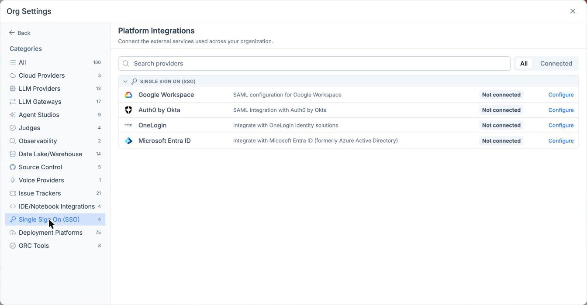

GGX signs users in through SAML. All four providers listed under **Single Sign On (SSO)** in **Org Settings → Integrations** share one connection: selecting **Configure** on any of them opens the same **Configure SSO** dialog, and all four show the same status.

| Provider | Page |
| --- | --- |
| Google Workspace | [Google Workspace](google-workspace/) |
| Auth0 by Okta | [Auth0 by Okta](auth0/) |
| OneLogin | [OneLogin](onelogin/) |
| Microsoft Entra ID | [Microsoft Entra ID](microsoft-entra-id/) |

## Who sets it up

Org Settings → Integrations is available to organization administrators. A user without write access sees the SSO configuration read only, without **Save** or **Remove**.

For self-hosted installations, an administrator also has to allow SAML login in the API configuration. See [SAML Single Sign-On](../../technology/self-hosting/configurations/saml/).

## How users sign in

When SAML login is allowed, the sign-in page shows an **SSO** button next to the other sign-in options. Selecting it sends the user to your identity provider. After the provider confirms the user, GGX opens with the user signed in.

## Fields of the Configure SSO dialog

Saving needs the three required fields of the service provider and identity provider sections. Everything else is optional unless a toggle below asks for it.

### Service Provider Settings

| Field | What to enter |
| --- | --- |
| Entity ID | Required. Pre-filled with `<your GGX address>/api/v1/saml/metadata`. Register the same value in your identity provider. |
| Assertion Consumer Service (ACS) URL | Read only: `<your GGX address>/api/v1/saml/acs`. Copy it into your identity provider. |

### Identity Provider Details

| Field | What to enter |
| --- | --- |
| Identity Provider Entity ID | Required. The entity ID of your identity provider. |
| Single Sign-On Service URL | Required. The URL where GGX sends the sign-in request. |
| Enable Single Logout | Select to show **Single Logout Service URL**. Leaving that URL empty turns single logout off again. |
| X.509 Certificate Hash | The identity provider's X.509 certificate. GGX needs it to trust the sign-in response. |

### Attribute Mapping

| Field | Behaviour |
| --- | --- |
| Username | **Use Name ID** takes the SAML Name ID as the username. **Derive from SAML Attribute** reads the attribute name you enter. |
| User Email | The same two options as Username. |
| Assign Project Roles from SAML | When selected, enter the role attribute. The values of that attribute are matched to GGX team names, and the user's teams are replaced with the matches at each sign-in. |
| Department, Title, First Name, Last Name | Optional. Enter the attribute that carries each value. |

**Save** stores the configuration. **Remove** deletes it. **Remove** appears only after a configuration has been saved.

## Notes

- The configuration is per organization and applies to every user.
- If no SSO configuration is saved in Org Settings, GGX reads the `SAML_SETTINGS` of the API configuration instead.
