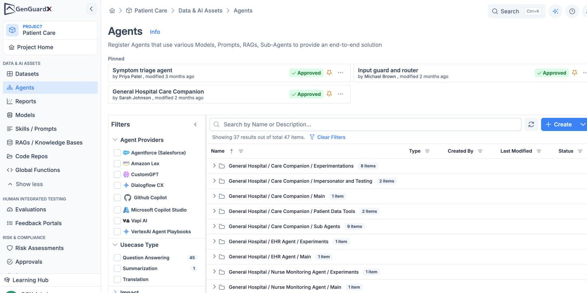
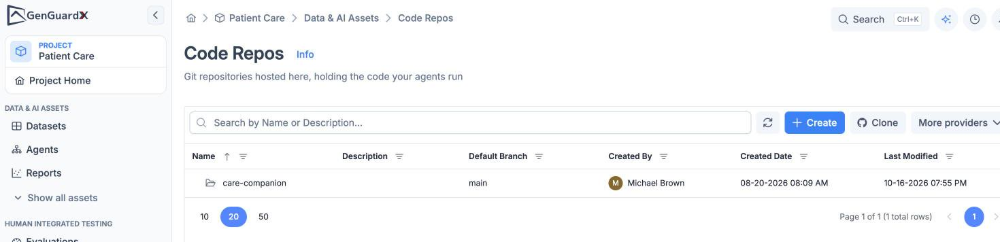

## Overview

The platform allows registering, tracking, and monitoring of Data and GenAI assets (like RAG, Models, LLMs and Agents) at a centralized location.

## Why Inventory Management is Helpful?

- **Governance and Compliance:** Helps track AI models, datasets, and dependencies for regulatory audits.
- **Reusability & Efficiency**: Prevents duplication of efforts by enabling teams to reuse registered and approved assets and standardized inventories reducing onboarding time for new teams.
- **Security & Access Control**: Centralized inventories allow proper role-based access management.
- **Monitoring & Continuous Improvement**: Ensures GenAI systems can be tested before moving to production and periodically monitored post-production.

## Asset Registries:

Read more on different registries below:

Registries live under **Data & AI Assets** in each project. **Datasets**, **Agents** and **Reports** are always in the sidebar; click **Show all assets** for the rest.

| Registry in the app | What it holds | Docs |
| --- | --- | --- |
| **Datasets** | Tables and chat datasets used for evaluation and monitoring | [Data Assets](table-registry/) |
| **Agents** | End-to-end agents (pipelines) | [Agents](pipelines/) |
| **Reports** | Evaluation reports and dashboards | [Reporting](../../evaluate-and-approve/reporting/) |
| **Models** | LLMs and other models | [LLMs and Models](model-catalog/) |
| **Skills / Prompts** | Prompt templates | [Prompts](prompts/) |
| **RAGs / Knowledge Bases** | Retrieval components | [RAGs](rags/) |
| **Code Repos** | Git repositories hosted in GGX, holding code that agents run | [Code Repos](#code-repos) |
| **Global Functions** | Reusable Python functions | [Global Functions](global-functions/) |

## Code Repos

**Code Repos** are Git repositories hosted in GGX that hold the code your agents run. Click **Create** for a new repository, **Clone** to bring in an existing one from GitHub, or **More providers** for other Git hosts. An agent of type **Code Repo** runs the latest commit of the branch you choose, so new commits reach the agent without saving it again.

### Where you can clone from

| Provider | Hosts | Set up in |
| --- | --- | --- |
| [GitHub](../../integrations/source-control/github/) | github.com | **My Account → Integrations** |
| [GitHub Enterprise Server](../../integrations/source-control/github-enterprise-server/) | A GitHub server your organization runs | **Org Settings → Integrations** |
| [GitLab](../../integrations/source-control/gitlab/) | gitlab.com or a self-managed GitLab | **Org Settings → Integrations** |
| [Bitbucket](../../integrations/source-control/bitbucket/) | Bitbucket Cloud | **Org Settings → Integrations** |
| [Other Git server](../../integrations/source-control/git-server/) | Any Git server over HTTPS or SSH | **Org Settings → Integrations** |

In **More providers**, a provider your administrator has not turned on shows **Not enabled yet**. Organization administrators get a **Set up** button there. Each person connects their own account, and GGX uses it to clone, sync, and push. Cloning brings in the branches and commit history.

### Clone and sync

A large repository can take several minutes to clone. You can leave the page: the files open once the clone is ready. If a clone fails, the repository shows **The repository could not be cloned** with the reason, and **Try again** repeats it.

In the repository, the sync button pulls new commits from the remote. Next to it, a count shows how many commits the branch is behind or ahead of the remote, and a separate marker shows that the branch has diverged.

### Use a Code Repo as an agent

Create an agent of type **Code Repo** and choose:

1. **The Code Repo.** Use the reload button if you added one a moment ago.
2. **The branch.** It starts as the default branch. Each chat message runs the commit the branch is at when the message is sent.
3. **The agent.** GGX looks for agents in the branch. Choose one under **Pick from detected agents**, or choose **Provide manually**.

When you pick an agent, GGX fills in three fields that you can edit:

- **Python path**: the folders of the repository that code is imported from, relative to its root, separated by `:` as in `PYTHONPATH`. The first folder that has a module wins. GGX detects a starting value: the folder the agent's module is imported from, then the folder of the project it belongs to (the closest one with a `pyproject.toml`), then the folders of other packages in the repository such as a shared library. **Use the detected one** puts it back. Empty means the root of the repository.
- **Import statement**: how Python imports the agent, in the form `from <module> import <agent>`, such as `from my_pkg.agent import graph`.
- **Framework**: the agent framework. It is required.

GGX reads the Python files of the repository without importing or running them. Agents that it finds but cannot run are marked **not supported yet**.

#### Supported agent frameworks

GGX can run agents built with these ten frameworks:

- LangChain
- LangGraph
- Deep Agents
- OpenAI Agents
- Google ADK
- Strands Agents
- Claude Agent SDK
- CrewAI
- AutoGen
- Pydantic AI

## How Platform Helps in Managing Inventories?

The platform offers extensive capabilities to streamline onboarding and efficiently manage assets.

- Multiple registries are available to centralize and manage smaller, reusable components of the agent.
- Customized groups for creating assets within a registry.
- Permissible Purpose Tracking that enables automatic validation to ensure components are used only for authorized purposes.
- Flexible and granular access management.
- Change History tracking for registered assets.
- Lineage Tracking of registered assets.
- Sharing of assets within and across teams.
- Creating Custom Fields for the registry apart from the default ones.

## Metadata Tagging

When any item is added to an entity - during the registration, various fields can be tagged to that object. Some basic fields are mandatory - for example:

- Alias - A Python variable name to refer to the object by
- Type - The data type that the object returns
- Description - A free format field that can be used to describe the object being created.
- Group - Useful to organize items, making them easier to search and find later
- Permissible Purpose - A governance tracking mechanism to ensure items are used correctly
- Location (of Data) - A data lake location where the data resides and can be fetched from
- Training & Validation Data - Used when creating models

New fields can be added to any of the registries to facilitate better inventory management in Settings > Fields & Screens section. Fields of various types can be added:

- Short Text
- Long Text
- Date Time
- File
- Single Select
- Multi Select
- Multiple Files

They can be marked as mandatory and customized with descriptions, placeholder values, default values, etc. and even be made mandatory to fill in. Values for fields can also be programmatically computed - with Python formulae.

### Data Type

Data Types on the platform are useful to declare clear types that can be used for documentation. Data Types are very flexible on the platform. The types supported are:

- Scalar Types:

  - Numerical
  - String
  - DateTime
  - Boolean

- Array Types:

  - Array[Numerical]
  - Array[String]
  - Array[Array[DateTime]]
  - and other types can be created by mixing existing types ...

- Struct Types:

  - Struct[decision: String, ranking: Numerical]
  - Struct[amt: Array[Numerical], flag: Boolean]
  - Struct[info: Map[Numerical,String],details: Struct[id: String,date: DateTime,age: Numerical]]
  - and other types can be created by mixing existing types ...

- Map Types:

  - Map[Numerical, String]
  - Map[String, Numerical]
  - Map[Numerical, Array[Boolean]]
  - and other types can be created by mixing existing types ...
