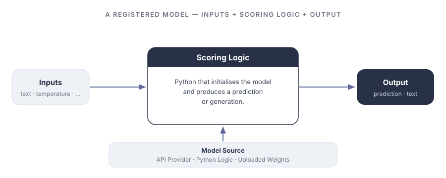
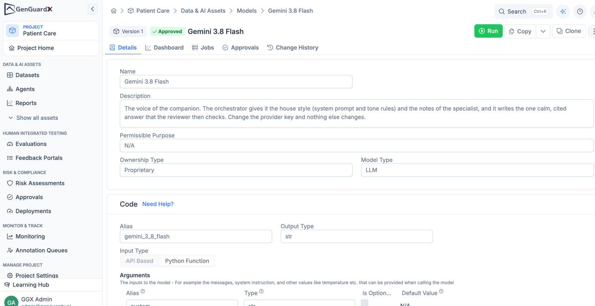

import { Badge, LinkCard, Steps, Tabs, TabItem } from '@astrojs/starlight/components';

<helper-panel object='FoundationModel' location='list'>

## What is a model?

A **model** is a software program that uses algorithms or rules to make informed decisions, predictions, or generations from a set of inputs without being given explicit instructions for every scenario — ML models, lookup tables, if-else rules, and LLMs all qualify.

A registered model in GGX includes:

- **Scoring Logic** — the code that takes inputs and produces a prediction or generation.
- **Arguments and an Output Type** — the typed inputs the model accepts and the type of value it returns.
- For an API Based model, the **Model Provider** and **Model** it calls.

<figure class="ggx-figure">



<figcaption>Inputs flow into scoring logic, which calls a model source and returns the model's output.</figcaption>
</figure>

## The two input types

Every model registered in GGX has one of two **Input Types**: **API Based** or **Python Function**. Choosing the right one is the first real decision you make on the registration form — it determines how the model is called and how it is configured.

<Tabs>
<TabItem label="API-Based">

<Badge text="External provider" variant="tip" /> **Best for** hosted models reached through a provider or gateway that you connect under **Org Settings → Integrations**.

- You pick the **Model Provider** and the specific **Model** from the dropdowns.
- Picking a provider fills the Scoring Logic editor with example code for that provider. If you already edited the code, GGX asks before replacing it.
- The provider's credentials come from its integration, as environment variables, not from the code.

</TabItem>
<TabItem label="Python Function">

<Badge text="In-platform code" variant="note" /> **Best for** lightweight Python logic, rule-based models, or anything that runs inside GGX without an external file.

- Write the model's logic directly in the Scoring Logic editor.
- Use the libraries installed in your environment, see [Python packages](../../../administration/python-packages/).
- No provider or model is selected.

</TabItem>
</Tabs>

## Adding a model to the catalog

The **Models** page (**Data & AI Assets → Models**) is the central place where every registered model lives, organised into customisable groups. From here you can track, monitor, test, and create new models.

Click **Create** on the Models page, then work through the form:

<Steps>

1. **Name and description.** Give the model a clear name and a description of what it does and when to use it.

2. **Properties.** Set the **Group**, **Permissible Purpose**, **Approval Workflow**, **Ownership Type** (Proprietary, Open Source, Internal), and **Model Type** (for example, *LLM*).

3. **Alias.** <Badge text="required" variant="caution" /> A code-safe variable name agents use to refer to this model — lowercase with underscores, no spaces.

4. **Input Type.** Pick **API Based** or **Python Function**. If API Based, also pick the **Model Provider** (required) and the **Model**. See [Model providers](#model-providers).

5. **Output Type.** The data type the model returns, e.g. `dict[str, str]`.

6. **Input Arguments.** For each argument (typically `text`, `temperature`, `system_instruction`, etc.), set its **Alias**, **Type**, whether it is optional, and a default value.

7. **Resources.** Click **Add Resources** to attach registered Global Functions, Prompts and other objects the scoring logic needs.

8. **Scoring Logic.** Write the Python that initialises the model and produces a result. Use **Test Code** to run test code against the model. Save the model code before you run it.

9. **Save.** Add notes or attach documentation under **Additional Information**, then click **Create**. The model is saved as a **Draft** until it goes through approval.

</Steps>



:::note[Credentials live in Integrations, not in code]
For API Based models, authenticate using environment variables exposed through **Platform Integrations** (e.g. `GOOGLE_API_KEY`, `OPENAI_API_KEY`). Do not paste keys into Scoring Logic.
:::

</helper-panel>

## Model providers

The **Model Provider** list on an API Based model contains the services in the **Cloud Providers**, **LLM Providers** and **LLM Gateways** categories of **Org Settings → Integrations**, plus **Other**. Each provider shows the models GGX knows for it in the **Model** list, so the list is not limited to six providers. The credentials and fields each provider needs are on its integration page:

| Category | Page |
|----------|------|
| **Cloud Providers** (Azure AI, Google Vertex AI, Amazon Bedrock) and **LLM Providers** (for example OpenAI, Anthropic, Deepseek, Groq, Together AI, Fireworks AI, Mistral AI, Cohere, xAI, Ollama, vLLM) | [Setting up Integrations](../../../integrations/llm-providers/) |
| **LLM Gateways** (for example LiteLLM Proxy, OpenRouter, Portkey, Kong AI Gateway) | [LLM Gateways](../../../integrations/llm-gateways/) |

- **Model** appears once a provider other than **Other** is selected. Its last entry is **Other**, for a model that is not listed.
- **Other** as a provider means a provider that is not listed. It has no model list and no example code.
- **Judges**, a separate category in the integrations catalogue, is not in the provider list.

:::caution[Provider not connected]
When you select a provider that is not connected, an editable model shows **This model provider is not integrated** with a **Connect now** button that opens the provider's integration form. In a project, GGX checks the integrations the project uses; outside a project, it checks the organization's. The model's code needs the provider's credentials to call it.
:::

<LinkCard title="All LLM provider integrations" description="Browse every supported provider and how to wire up its credentials." href={`${import.meta.env.BASE_URL}integrations/llm-providers/`} />

## Testing a model

Testing a model means confirming three things: the scoring logic runs without error, it can reach its source (provider API or in-platform code), and the output matches the **Output Type** you declared. GGX gives you two levels for this.

### Quick check — Test Code in the editor

On a model's page, the **Test Code** button on the Scoring Logic editor opens a box where you write test code that calls the model, and **Run** executes it. The resources used in the model are available there as Python functions. Save the model code before you run the test. Use it during development to:

- Confirm the API credentials configured in Integrations actually reach the provider.
- Verify the return value matches the declared **Output Type** (e.g. `dict[str, str]`).
- Sanity-check temperature, max-token, and system-instruction handling.
- Catch import errors or missing dependencies.

### Bulk simulation across a dataset

A single Test Code call tells you the model *works*; a **Bulk Simulation** tells you how it behaves across many real cases. It runs every row of a dataset through the model and produces one output per record — useful for:

- Spotting edge cases (empty input, very long input, non-English) a single test would miss.
- Measuring quality across a representative sample before promoting to production.
- Attaching the run as evidence in the model's risk-assessment evidence tab.

## A worked example: Gemini 2.0 Flash

Registering Google's **Gemini 2.0 Flash** as an API-Based model. The form fields:

| Field | Value |
|-------|-------|
| Name | Gemini 2.0 Flash |
| Alias | `gemini_2_0_flash` |
| Input Type | API-Based |
| Model Provider | Google Vertex AI |
| Output Type | `dict[str, str]` |
| Input Arguments | `text` (String, required) · `temperature` (Numerical, optional, default `0`) · `system_instruction` (String, optional, default `None`) |

The scoring logic authenticates with an environment-variable token and calls Vertex AI:

```python title="gemini_2_0_flash — scoring logic"
import os
from google import genai
from google.genai import types

client = genai.Client(api_key=os.getenv("GOOGLE_API_KEY"))

config = types.GenerateContentConfig(
    temperature=temperature,
    seed=2025,
    system_instruction=system_instruction,
)

response = client.models.generate_content(
    model="gemini-2.0-flash",
    contents=text,
    config=config,
)

return {"response": response.text}
```

:::tip[Where the API token comes from]
You never hard-code the key. The `os.getenv("GOOGLE_API_KEY")` value is supplied by connecting the provider on the **Org Settings → Integrations** page — find the provider (here **Google Vertex AI**, under **Cloud Providers**), click **Configure**, add its credentials, and GGX exposes them to scoring logic as environment variables.

If your provider is **not** in the list, use **Other OpenAI-compatible gateway** under **LLM Gateways**, or set the environment variable for your deployment, then reference it the same way with `os.getenv(...)`.
:::

Once saved, it can be called from any downstream agent:

```python
reply = gemini_2_0_flash(
    text=user_prompt,
    temperature=0.7,
    system_instruction="You are a helpful assistant.",
)
output_text = reply["response"]
```

<LinkCard title="Full Gemini 2.0 Flash walkthrough" description="The complete registration guide with screenshots for every field." href={`${import.meta.env.BASE_URL}register-and-refine/examples/model/`} />

## Models as evaluators (LLM-as-a-judge)

A registered model is not only the thing being tested — it can also be the thing that *does* the testing. An **LLM-as-a-judge** is simply a model whose scoring logic pairs an LLM with a **Prompt** to score another system's output against criteria, returning a structured score (for example, answer relevancy on a `0–4` scale) and a reason.

Because a judge is a registered model, it is **reusable** across any [Report](../../../evaluate-and-approve/reporting/) and pre/post-production evaluation, and it can itself be **validated**: run it over a ground-truth dataset with [Bulk Simulation](../../../evaluate-and-approve/simulation/) and compare its verdicts to the known answers before you trust it. Refine its prompt — including via [Prompt Optimization](../../prompt-optimization/) — to adapt a generic judge to your use case.

:::tip[Heuristics first, judges for nuance]
Pair judges with cheap, deterministic checks. Rule-based heuristics (token, length, and cost thresholds; staleness; keyword failures; library-based PII detection) triage the obvious cases instantly; reserve LLM judges for the quality questions rules cannot answer.
:::

## Capabilities unlocked by registration

Registering a model — rather than calling it from a one-off script — is what turns it into a governed, reusable asset:

| Capability | What you get |
|------------|--------------|
| **Change tracking** | Every modification to a draft is snapshotted in Change History; approved versions are locked. |
| **Purpose enforcement** | Automatic detection of Permissible Purpose violations when the model is used downstream. |
| **Testing & evaluation** | Quick Test Code during development and Bulk Simulation across datasets before promoting. |
| **Reusability** | Reuse across agents, with visibility through [Lineage Tracking](../../lineage-tracking/). |
| **API fingerprinting** | External API connectivity is fingerprinted so changes upstream are detectable. |
| **Auditable path to production** | A transparent, fully auditable journey from Draft through Approval to use in agents. |
| **Executable artifacts** | Extract ready-to-productionise artifacts straight from the Catalog. |
