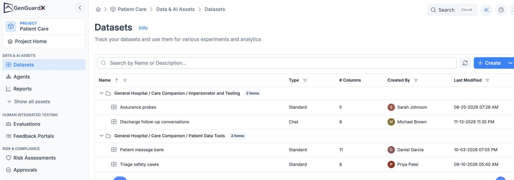
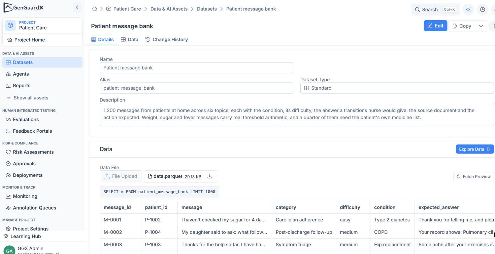

<helper-panel object='DataTable' location='list'>

The **Datasets** page (**Data & AI Assets → Datasets**) records the location, content, and structure of source data tables used for analytics.

The table can be registered using one of the following methods:

- **Cloud file storage:** Point to a file or folder in Amazon S3 (`s3://`), Google Cloud Storage (`gs://`) or Azure Blob (`abfss://`). The location must be a `.csv`, `.parquet` or `.orc` file, or a folder of such files.

- **Warehouses and databases:** Read a table by its path, or run a SQL query, on Snowflake, Amazon Redshift, Google BigQuery, Azure Synapse / Microsoft Fabric, PostgreSQL, MySQL / MariaDB, Apache Hive, Oracle, MSSQL or any other JDBC database. Each needs a connection and a Python driver; see [Data sources](../../../integrations/data-warehouses/data-sources/).

- **Local File Path:** Read a file from a path on the GGX machine.

- **Table Upload:** Datasets with fewer rows can be uploaded directly in CSV or Excel format.

- **Databricks:** Use a configured Databricks integration to read a table by its full path or run a SQL query. See [Register a Databricks dataset](#register-a-databricks-dataset).

- **Custom Logic:** Use a custom reader for other data formats or providers.

> **Note:** Large or production-scale datasets should be registered through the **cloud storage or warehouse connection** rather than uploaded through the browser. The data is then read directly from its source location (for example a cloud bucket or a Parquet file), avoiding slow uploads while remaining viewable as a table.

## Managing Tables on the Platform

The **Datasets** page organizes all the registered tables into customized groups at this centralized location and allows easier tracking, monitoring, and creating new ones.

### Registering a Table:

- Click on **Create** button on the Datasets page.
- Fill in important details like **Name**, and **Attributes** (Alias, Group, Input Type, Location, Description).
- Select the source in **Location** and provide the data link, uploaded file, Databricks table or query, or custom read logic as appropriate.
- Finally, click on the **Save** button to complete the registration.

Each dataset has a **Dataset Type**: **Standard** for one record per row, or **Chat** for conversations.

> **Note:** A dataset's **Data** section shows its source (for example an uploaded `data.parquet` file) and the query that reads it. Click **Fetch Preview** to load the first rows, and **Explore Data** to browse the full table. The **Data** tab, the **Insights** tab and the **Change History** tab sit next to **Details**.

Once the table is registered, data quality can be evaluated through registered **Quality Checks** or it can be used for validation and testing.

### Chat datasets

A **Chat** dataset holds conversations, one per row, for evaluating chat agents. It needs two columns:

| Column | What it holds |
| --- | --- |
| `id` | A unique, non-empty ID for the conversation. |
| `messages` | The conversation: its messages with their roles. |

GGX refuses to save a Chat dataset that lacks either column. It reports *Chat datasets require the following columns: id, messages.*

#### Add chats from a feedback portal or an annotation queue

Instead of writing the file yourself, copy real conversations that reviewers have already looked at.

1. Open the source:
   - In a [feedback portal](../../../evaluate-and-approve/feedback-portals/), right-click one or more sessions.
   - In an annotation queue that has its **Chat Messages Column** mapped under **Details**, right-click one or more records.
2. Click **Add to dataset**.
3. In the **Add to a dataset** window, choose **A dataset that exists** and pick a Chat dataset in the same project, or choose **A new dataset** and enter a **Name** and an optional **Description**.
4. Click **Add to the dataset**, or **Create the dataset and add** for a new one.

A new dataset is created in the project's root folder. Move it into a folder from its page.

Chats the dataset already has are skipped, so adding the same chat twice never makes a copy. Sessions or records without messages are left out. You need write access to the destination dataset.

#### What the added rows contain

Added rows carry extra columns that record where each chat came from and what reviewers said about it:

| Column | What it holds |
| --- | --- |
| `source` | Where the chat was copied from: a feedback portal or an annotation queue, the portal or queue ID, the session or record, and a label such as *Mammogram review, session 40311*. |
| `feedback` | A list with one entry per reviewer: the message the feedback is about (or the whole chat), the reviewer, a thumbs up or down, and the comment. |

Rows from a feedback portal also have `session_name`, `agent_version`, `thumbs_up`, `thumbs_down` and `testing_notes`. The `id` of a portal row names the portal and the session. In a queue without an ID column mapped, the `id` is built from the queue and the record number.

### Register a Databricks dataset

First, configure [Databricks under Org Settings → Integrations](../../../integrations/data-warehouses/databricks-unity-catalog/#connect-databricks-in-ggx). Then create a dataset and choose **Databricks** in the **Location** source selector. Use **Connect now** if the integration has not been configured.

Choose either **Table path** and enter `catalog.schema.table_name`, or **SQL query** and enter a read-only `SELECT` query. The configured Databricks SQL warehouse executes the read. Save the dataset, use **Fetch Preview** to load its rows and schema, and check its contents through **Explore Data**.

**GGX treats Databricks as read-only and does not write to the warehouse.** Registering a dataset does not create a full copy of Databricks; GGX reads the selected table or query results for processing.

### Insights tab: statistics, quality, pages and issues

The **Insights** tab sits next to **Data** and shows what is in the dataset. Its sidebar lists **Statistics**, **Quality**, **Issues**, and your own **Pages** of figures.

| Item | What it shows |
| --- | --- |
| **Statistics** | Plain counts for each column. Click **Refresh** to recompute them. For a large dataset, column figures come from a sample and a note says so; the number of records is exact. |
| **Quality** | Checks on the data, each with a result and, when something was found, example rows (**Show examples**). Click **Refresh** to run them again. |
| **Issues** | Problems that people have reported in the data. See [Track issues in a dataset](#track-issues-in-a-dataset). |
| **Pages** | Pages of figures that you write. See [Build figure pages](#build-figure-pages). |

Everyone who can read the dataset sees these items. Pages and issues are not part of the dataset's version or change history, and a copy of a dataset does not copy its pages.

#### Build figure pages

If you can write to the dataset, click **Add page**, enter a **Name** and click **Add page** again. Open a page and click **Add figure**. A figure is a chart, a table or a Markdown summary, computed by Python that you write over the dataset.

| Field | What it does |
| --- | --- |
| **Name** | The title of the figure. |
| **Width** | **Full width**, or **Half width** so that two figures sit side by side on a wide screen. |
| **Refresh mode** | **Live** runs the code on the data each time the page opens. **Snapshot** keeps the result of the last run and shows it without reading the data; the figure is tagged with the date it was computed. |
| **Figure Logic** | The Python code. `data` is the dataset. Return a Plotly figure, a Markdown string or a DataFrame. |

In **Figure Logic**, **Start from…** inserts a starter for the dataset's columns and **View Examples** shows sample code. Click **Run** to preview the result, then **Save**.

Click **Recompute figure** on a figure to run its code again and, for a **Snapshot**, replace the kept result. Use **Snapshot** for slow figures or when you want a result that does not move; use **Live** when the figure must always match the data. A dataset of more than a million records is read as a random sample.

The menu next to a page lets you **Rename**, **Move up**, **Move down**, **Duplicate** and **Delete** it. On a figure you can drag it to reorder, switch between full and half width, and move it to another page.

#### Track issues in a dataset

The **Issues** item tracks problems in the data, such as wrong labels, bad rows, duplicates or missing values. Each issue has a number, a title, a summary, a status and an optional assignee, and it points at the rows that show the problem as evidence.

Click **New issue** to report one. Add rows as evidence by their number: 1 is the first row. Filter the list as **Open** or **Closed**, by **Status**, **Found by** or **Assignee**, or search it.

| Status | Meaning |
| --- | --- |
| **Needs review** | Not yet reviewed. Counts as open. |
| **Open** | Reviewed and still to be handled. |
| **Resolved** | Fixed. |
| **Won't fix** | Accepted as it is. |
| **Duplicate** | Merged into another issue. |

Anyone who can write to the dataset can report and handle issues. Dataset issues are reported by people only: there is no automatic issue finder and no discussion thread.

### Reuse a registered dataset

- Select it in **Data Sources** when running a [Simulation](../../../evaluate-and-approve/simulation/) on a Model, Prompt, RAG, or Agent.
- Use it as the shared data source for a [Comparison](../../../evaluate-and-approve/comparison/) between an object and its challengers.
- Link it to a [Quality Check](#what-is-a-quality-check) to profile the data and run quality reports.
- Attach evaluation jobs and reports to an [Approval Workflow](../../../evaluate-and-approve/approval-workflows/) as evidence for review.

## Benefits of Table Registration:

- Automated **change history records** that tracks all the modifications to the tables.
- **Track the lineage** of table usage in downstream applications.
- Run **Quality Checks** on the tables.
- Use tables for validation and testing in a **fully auditable** manner.
- **Export tables** outside the platform when required with a single click.

</helper-panel>

<helper-panel object='QualityProfile' location='list'>

## What is a Quality Check?

The Quality Check enables the analysis of data and the creation of standard or custom reports based on tables registered under Datasets. It supports the generation of profiling metrics, descriptive statistics, invalid entry detection, outlier analysis, and other custom reports and metrics to assess data quality effectively before using the data for downstream tasks like running jobs.

> **Note:** The Quality Check object currently supports linking only one table at a time, enabling the generation of multiple metrics and reports for a single table per analysis.

## Managing Quality Checks on the Platform:

The **Quality Check Registry** organizes all the registered quality checks into customized groups at this centralized location and allows easier tracking, monitoring, and creating new ones.

### Registering a Quality Check:

1. Click on **Create** button in Quality Check registry.
2. Fill in important details like **Name**, **Attributes** (Data-Table, Group, Descriptions, Select Data-Columns).
3. **Add notes**, **attach documentation** if available in the **Additional Information** section.
4. Lastly, click on the **Save** button to complete the registration process.

## Benefits of Quality Check Registration:

- **Analyze and monitor data** using standard and custom reports.
- **Share data analysis and evaluations** with other team members.

</helper-panel>
