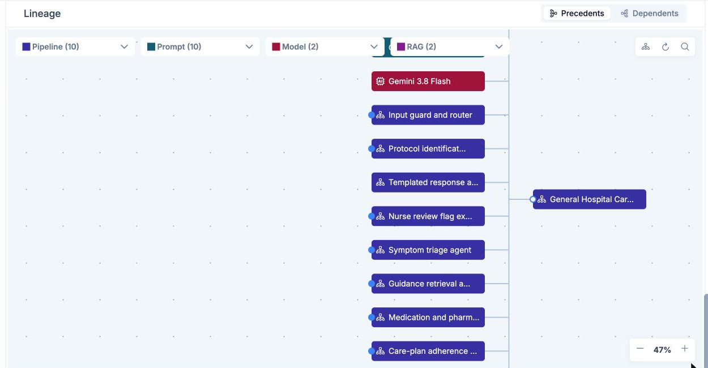

Lineage tracking records and visualizes the complete lifecycle of an object and depicts the flow of execution, showing how objects interact, are transformed and executed. It captures its origins, building blocks used, transformations, and usages across the organization.

## Why Lineage Tracking is Important?

- **Ensures Traceability** by providing a clear link between all artefacts, ensuring transparency in dependencies and usages.
- **Easier Impact Assessment** for modifications.
  - Provides a clear view of all dependent objects that would be affected by changes.
  - Identifies necessary updates across dependencies to introduce changes.
- **Enhances Collaboration** by providing visibility into how different teams and models interact within the agent.
- **Ensures Compliance** with regulations like the **[EU AI Act (Article 13 & 14)](https://eur-lex.europa.eu/resource.html?uri=cellar:e0649735-a372-11eb-9585-01aa75ed71a1.0001.02/DOC_1&format=PDF)**, which mandates transparency and human oversight.
- **Identifying redundant processes**.

## Lineage Structure on GGX Platform:

A lineage is created and automatically maintained by the platform as soon as an object is registered. It appears in the **Lineage** section at the bottom of the object's **Details** tab, as a horizontal tree that maps how the object is built and where it is used.

Switch between two views at the top right of the section:

- **Precedents (inputs)**: the sources and dependencies the object is built from, such as the prompts, models, RAGs and sub-agents of an agent.
- **Dependents (usage)**: the other objects that rely on this one.

The legend at the top counts the objects of each type in the graph (for example *Pipeline (10)*, *Prompt (10)*, *Model (2)*, *RAG (2)*); open a type to find a specific object. Use the controls at the top right to change the layout, refresh or search, and zoom with the controls at the bottom right. Click a node to see its details and open it.

